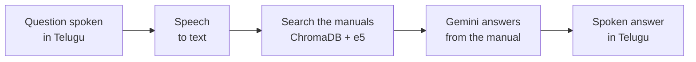
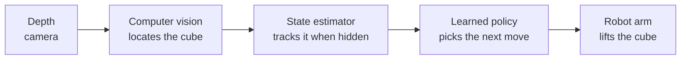

# My AI Engineering Journey

**Production LLM applications and robot learning, built end to end, with the engineering notes behind them.**

Rishi Sasanala · [Email](mailto:rishisasanala@gmail.com) · [GitHub](https://github.com/rishisasanala)

[Projects](#featured-projects) · [Skills](#skills-and-technologies) · [Engineering notes](#engineering-notes) · [Roadmap](#roadmap) · [Contact](#contact)

---

## About

This repository is my AI engineering portfolio. Both projects are my own work: I designed, built and tested both, and deployed Yodha to production.

- **[Yodha](#yodha-telugu-voice-ai-assistant)**, a Telugu voice assistant that answers vehicle questions from the manuals, is in production on Azure. Its application and model-training code live in a [separate repository](https://github.com/SEVT-Logistics-Private-Limited/tiny-llm-jetson); the write-up is here.
- **[Vision-RL Pick-and-Lift](#vision-rl-pick-and-lift)**, a robot-learning prototype in simulation, lives entirely in this repository: code, trained model, tests and CI.
- **[34 engineering notes](#engineering-notes)** explain the concepts the projects rely on, from GPUs to RAG. Each ends with where the concept appears in the code.

## Featured projects

### Yodha: Telugu Voice AI Assistant

**Ask a vehicle question out loud in Telugu and hear the answer in Telugu, grounded in the vehicle manuals.** In production on Azure Container Apps; sign-in required.

- **Problem:** vehicle manuals are long and written in English, so answers are slow to find for Telugu speakers.
- **What I built:** a browser voice interface, a FastAPI service that retrieves the relevant manual section and has Gemini answer from it, and Telugu speech output. It runs on Azure, and tests gate every deployment.
- **Engineering:** Telugu questions are searched directly and translated to English only when that misses · three-model LLM fallback with retry · answers streamed token by token, spoken sentence by sentence · PBKDF2 password hashing, signed tokens and rate limiting · HSTS, clickjacking protection and a Content-Security-Policy.
- **Next:** a retrieval evaluation set to measure answer quality and latency ([roadmap](ROADMAP.md)).

[Project write-up](projects/telugu-voice-assistant/README.md) · [Live assistant](https://telugu-voice-app.gentletree-f4002f64.southindia.azurecontainerapps.io/assistant) (sign-in required) · [API specification](https://telugu-voice-app.gentletree-f4002f64.southindia.azurecontainerapps.io/openapi.json) · [Implementation & Source Code → Tiny LLM on NVIDIA Jetson](https://github.com/SEVT-Logistics-Private-Limited/tiny-llm-jetson)

### Vision-RL Pick-and-Lift

**A simulated robot arm finds a cube with a depth camera and picks it up, using a control policy learned by reinforcement learning in about 18 minutes on a 4-core CPU.** Research prototype: simulation only, not yet tested on a physical robot.

Results on 100 held-out test episodes. Success means the cube is held and lifted at least 5 cm:

| Controller | Success |
|---|---|
| Learned policy, acting on the camera | **99%** |
| Learned policy, cube rotated up to ±45°, never seen in training (cube position from the simulator) | **100%** |
| Hand-written baseline, no learning | **100%** |

- **Perception:** 1.8 mm mean 3D localisation error over 100 placements.
- **About the baseline:** a hand-written controller also solves every test case, which shows the task is solvable. The learned policy matches it within one episode while learning the behaviour from rewards alone.
- **Engineering:** diagnosed and fixed reward hacking · a camera-plus-joint-sensor state estimator raised camera-driven success from 21% to 98% on development seeds · physics rebuilt each episode for bit-identical runs · 47 tests in CI, plus regression gates on the trained policy.
- **Reproducible:** every success rate above reproduces exactly from a clean install (re-checked November 2026).

[Project write-up](projects/vision-rl-pickplace/README.md) · [Results](projects/vision-rl-pickplace/README.md#results) · [Engineering challenges](projects/vision-rl-pickplace/README.md#engineering-challenges) · [Quickstart](projects/vision-rl-pickplace/README.md#quickstart) · [Source code](projects/vision-rl-pickplace)

## Skills and technologies

| Area | Demonstrated with |
|---|---|
| **LLM applications** | Retrieval-augmented generation with ChromaDB and multilingual-e5 embeddings · prompt design · model fallback · Gemini API (Yodha) |
| **Backend and deployment** | Python · FastAPI · Pydantic · Server-Sent Events · Docker · GitHub Actions · Azure Container Registry and Container Apps (Yodha) |
| **Security** | PBKDF2-SHA256 password hashing · HMAC-signed, expiring tokens · rate limiting · CSP and HSTS headers (Yodha) |
| **Model training** | Transformers written from scratch in PyTorch · bf16 and gradient checkpointing · GPU memory planning on a Jetson Orin Nano and an A100 ([Telugu model and scaling study](docs/02-gpu.md#in-our-project)) |
| **Robot learning** | Gymnasium environment design · SAC with Stable-Baselines3 · reward shaping · held-out evaluation protocol (Vision-RL) |
| **Computer vision and robotics** | OpenCV RGB-D perception · pinhole camera model · state estimation · inverse kinematics in PyBullet (Vision-RL) |
| **Engineering practice** | pytest · CI regression gates on a trained model · seed-deterministic simulation · validated configuration (Vision-RL) |

## Engineering notes

34 short pages on the concepts behind the projects, meant to be read in order. Every page follows the same format and ends with **In our project**, which shows where the concept is used in the code. [Full index with summaries and the learning path →](docs/README.md)

| Area | Topics |
|---|---|
| Hardware | [CPU](docs/01-cpu.md) · [GPU](docs/02-gpu.md) |
| Text, images and video | [Text](docs/03-text.md) · [Image](docs/04-image.md) · [Image Resolution](docs/05-image-resolution.md) · [Video](docs/06-video.md) · [Frame](docs/07-frame.md) · [FPS](docs/08-fps.md) |
| Language, vision and robotics | [NLP](docs/09-nlp.md) · [VLM](docs/10-vlm.md) · [VLA](docs/11-vla.md) · [LLM](docs/12-llm.md) · [ROS](docs/13-ros.md) |
| Tech stack | [RAG](docs/14-rag.md) · [API](docs/15-api.md) · [FastAPI](docs/16-fastapi.md) |
| Machine learning foundations | [ML](docs/17-ml.md) · [Supervised](docs/18-supervised-learning.md) · [Unsupervised](docs/19-unsupervised-learning.md) · [Semi-Supervised](docs/20-semi-supervised-learning.md) · [Reinforcement Learning](docs/21-reinforcement-learning.md) |
| Machine learning algorithms | [Linear Regression](docs/22-linear-regression.md) · [Logistic Regression](docs/23-logistic-regression.md) · [Decision Tree](docs/24-decision-tree.md) · [Random Forest](docs/25-random-forest.md) · [Gradient Boosting](docs/26-gradient-boosting.md) · [KNN](docs/27-knn.md) · [K-Means](docs/28-k-means.md) · [Naive Bayes](docs/29-naive-bayes.md) |
| Deep learning | [DL](docs/30-dl.md) · [Transformers](docs/31-transformers.md) |
| LLMs | [Prompt Engineering](docs/32-prompt-engineering.md) · [Hallucination](docs/33-hallucination.md) · [Tokenization](docs/34-tokenization.md) |

## Roadmap

| Status | Work |
|---|---|
| **Done** | Yodha v10.1 in production · Vision-RL Pick-and-Lift prototype with reproducible results · 34 engineering notes |
| **In progress** | Compressing a 3B model to run Yodha offline: Telugu LoRA fine-tune and ternary quantisation ([code](https://github.com/SEVT-Logistics-Private-Limited/tiny-llm-jetson/tree/main/compression)) |
| **Next** | Retrieval evaluation set for Yodha · Yodha running offline on a Jetson Orin Nano · domain randomisation, the first step from simulation toward a real robot arm |

Details, including the learning topics planned next: [ROADMAP.md](ROADMAP.md).

## Repository structure

- [`projects/telugu-voice-assistant/`](projects/telugu-voice-assistant): the Yodha write-up; its code lives in `tiny-llm-jetson`
- [`projects/vision-rl-pickplace/`](projects/vision-rl-pickplace): the robot-learning project's code, trained model and tests
- [`docs/`](docs): the 34 engineering notes, numbered in reading order
- [`assets/`](assets): diagrams used in the notes
- [`.github/`](.github): CI for the robotics tests and policy gates, and the docs link check
- [`ROADMAP.md`](ROADMAP.md): done, in progress and planned work

## Contact

I'm Rishi Sasanala. I build AI systems end to end, from training and evaluating models to shipping secure, tested services. Questions about any of this work are welcome.

[rishisasanala@gmail.com](mailto:rishisasanala@gmail.com) · [GitHub](https://github.com/rishisasanala) · Yodha AI, SEVT Logistics Private Limited
