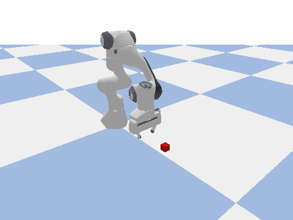

<div align="center">

# My AI Engineering Journey

**A structured guide to AI engineering, from computer fundamentals to LLMs, RAG and robotics, applied in a live production project.**


Yodha AI · SEVT Logistics Private Limited

[Topics](#topics) · [Featured Project](#featured-project) · [Robotics Project](#robotics-project) · [Learning Path](#learning-path) · [Roadmap](ROADMAP.md)

</div>

---

## Overview

Each topic is a short, consistent page: a clear explanation, a flow diagram, and how the concept is applied in our live **Telugu Voice AI Assistant**.

| At a glance | Detail |
|---|---|
| **Topics** | 34, grouped into 8 areas |
| **Applied in our project** | 14 of the 34 topics |
| **Page format** | Introduction · What it is · Why it is needed · How it works · Flow diagram · Real-world use cases · In our project |
| **Featured project** | [Telugu Voice AI Assistant](projects/telugu-voice-assistant/README.md), deployed on Azure Container Apps |
| **Author** | Rishi Sasanala |

## Learning path

Topics are designed to be read in order. Each builds on the previous one.

```text
Hardware                       CPU → GPU
                                     ↓
Text, images and video         Text → Image → Image Resolution → Video → Frame → FPS
                                     ↓
Language, vision and robotics  NLP → VLM → VLA → LLM → ROS
                                     ↓
Tech stack                     RAG → API → FastAPI
                                     ↓
Machine learning foundations   ML → Supervised → Unsupervised → Semi-Supervised → Reinforcement
                                     ↓
Machine learning algorithms    Linear Regression → Logistic Regression → Decision Tree → Random Forest
                               → Gradient Boosting → KNN → K-Means → Naive Bayes
                                     ↓
Deep learning                  DL → Transformers
                                     ↓
LLMs                           Prompt Engineering → Hallucination → Tokenization
```

## Topics

### Hardware

Every AI model runs on a processor. This section covers the two that matter most: the CPU, which works step by step, and the GPU, which does many calculations at once and makes training practical.

| # | Topic | Summary | Topics inside |
|---|---|---|---|
| 1 | [CPU](docs/01-cpu.md) | Step-by-step processing, binary, and how far LLM training can go on a CPU | Step-by-step (sequential) processing · Binary: the language of the CPU · Training an LLM on a CPU: how far you can go |
| 2 | [GPU](docs/02-gpu.md) | Parallel processing, number formats, and how far we trained on a GPU | Parallel processing · Number formats (bits per number) · How far you can train on a GPU · GPU memory usage |

### Text, images and video

Computers cannot read letters or see pictures, only numbers. This section starts with text, where every character is stored as a number. It then shows how an image is stored as a grid of pixels, where each pixel holds red, green and blue values, and how resolution decides how much detail an image keeps. It then builds up to video: a sequence of images (frames) shown at a fixed speed (FPS). These basics explain how AI models are able to "see".

| # | Topic | Summary | Topics inside |
|---|---|---|---|
| 3 | [Text](docs/03-text.md) | Characters stored as numbers | Characters · ASCII and Unicode · UTF-8 bytes · How a computer processes text · Text vs image vs video |
| 4 | [Image](docs/04-image.md) | Pixels and RGB values | Pixels · RGB colour values · How a computer processes an image |
| 5 | [Image Resolution](docs/05-image-resolution.md) | Width × height in pixels | Width × height · Megapixels (MP) · Resolution vs memory and GPU needs |
| 6 | [Video](docs/06-video.md) | Images played continuously | Video as a sequence of images · How a video is stored in a computer |
| 7 | [Frame](docs/07-frame.md) | One image inside a video | Image vs frame · Frames as the building blocks of video |
| 8 | [FPS](docs/08-fps.md) | Frames shown per second | Frames per second · 30 / 60 / 120 FPS · How much data one second of video holds |

### Language, vision and robotics

The main families of AI models: ones that understand language, ones that also see, and ones that also act. The section ends with ROS, the software that connects a robot's parts to those models.

| # | Topic | Summary | Topics inside |
|---|---|---|---|
| 9 | [NLP](docs/09-nlp.md) | Branch of AI that understands human language | What NLP is · What you are asking · What action you want · What information it needs |
| 10 | [VLM](docs/10-vlm.md) | Sees and understands (image + text) | Image + text understanding · How a VLM reads an image |
| 11 | [VLA](docs/11-vla.md) | Sees, understands and acts | Vision → language → action · VLM vs VLA |
| 12 | [LLM](docs/12-llm.md) | Trained on huge text to understand and generate language | GPT-style models · How an LLM reads text · How it generates an answer · Temperature |
| 13 | [ROS](docs/13-ros.md) | Connects and coordinates a robot's parts | What ROS does · How it fits with the other AI models |

### Tech stack

The building blocks used to turn a model into a working product: grounding answers in documents, and serving them over an API.

| # | Topic | Summary | Topics inside |
|---|---|---|---|
| 14 | [RAG](docs/14-rag.md) | Retrieve documents, then let the LLM answer | RAG vs fine-tuning · Document ingestion · Chunking · Embedding · Retrieval · Evaluating a RAG system |
| 15 | [API](docs/15-api.md) | How two software systems talk: request → response | Request → response · Types of APIs · REST and its methods · SOAP · REST vs SOAP |
| 16 | [FastAPI](docs/16-fastapi.md) | Building APIs in Python | Python functions as endpoints · Automatic `/docs` · Input checking · Request flow |

### Machine learning foundations

What machine learning is, and the four ways a model can learn, depending on what kind of data and feedback it gets.

| # | Topic | Summary | Topics inside |
|---|---|---|---|
| 17 | [ML](docs/17-ml.md) | Systems that learn patterns from data | AI vs ML · Rules vs learning from data · Types of ML (supervised, unsupervised, semi-supervised, reinforcement) |
| 18 | [Supervised Learning](docs/18-supervised-learning.md) | Learns from inputs with known outputs: classification and regression | Inputs + known target outputs · House-price example · Classification · Regression |
| 19 | [Unsupervised Learning](docs/19-unsupervised-learning.md) | Finds patterns in data without known outputs | No known target outputs · Customer-data example · Clustering · Anomaly detection · Supervised vs unsupervised |
| 20 | [Semi-Supervised Learning](docs/20-semi-supervised-learning.md) | Learns from a little labelled data plus a lot of unlabelled data | Labelled vs unlabelled data · 1000-emails example · How labels spread to unlabelled data · Supervised vs semi-supervised vs unsupervised |
| 21 | [Reinforcement Learning](docs/21-reinforcement-learning.md) | An agent learns decisions from rewards and penalties | Agent · Environment · Action · Reward and penalty · Bicycle example · The learning loop |

### Machine learning algorithms

The previous section covered the types of learning. Each page here is one classic algorithm. All are supervised except K-Means, which is unsupervised.

| # | Topic | Summary | Topics inside |
|---|---|---|---|
| 22 | [Linear Regression](docs/22-linear-regression.md) | Predicts a continuous number by fitting a straight line | Regression · Experience → salary example · Fitting a line · Predicting a new value |
| 23 | [Logistic Regression](docs/23-logistic-regression.md) | Predicts the probability of a class, then classifies | Classification · 1000-emails spam example · Features and learned weights · Probability → decision |
| 24 | [Decision Tree](docs/24-decision-tree.md) | Reaches a decision by asking a series of questions | Series of questions · Play outside or stay inside example · Learning from historical examples |
| 25 | [Random Forest](docs/25-random-forest.md) | Many independent Decision Trees combined | Multiple trees · Voting (classification) · Averaging (regression) · Independent trees |
| 26 | [Gradient Boosting / XGBoost](docs/26-gradient-boosting.md) | Models built one after another, each fixing earlier mistakes | Sequential models · 25 × 4 maths example · Random Forest vs boosting · XGBoost |
| 27 | [KNN](docs/27-knn.md) | Predicts from the nearest existing examples | Nearest examples · Movie example · What K means |
| 28 | [K-Means](docs/28-k-means.md) | Groups similar data points into K clusters | Clustering · Supermarket-customers example · Low / medium / high spenders · K-Means vs KNN |
| 29 | [Naive Bayes](docs/29-naive-bayes.md) | Uses probability to pick the most likely category | Probability per category · Email-words example · Naive Bayes vs Logistic Regression |

### Deep learning

Neural networks with many layers, how they are trained, and the Transformer architecture that modern LLMs are built on.

| # | Topic | Summary | Topics inside |
|---|---|---|---|
| 30 | [DL](docs/30-dl.md) | Multi-layer neural networks; epochs, batches, training | Neural networks · Epoch · Batch · Batch size · The training loop |
| 31 | [Transformers](docs/31-transformers.md) | The architecture behind LLMs: attention, Q/K/V, masking | Architecture · Embeddings · Encoder vs decoder · Self-attention · Query, Key, Value (Q/K/V) · Multi-head attention · Masking |

### LLMs

Working with large language models in practice: how to ask, why they sometimes make things up, and how text is turned into tokens.

| # | Topic | Summary | Topics inside |
|---|---|---|---|
| 32 | [Prompt Engineering](docs/32-prompt-engineering.md) | Zero/one/few-shot, chain of thought, role prompting | Zero-shot · One-shot · Few-shot · Chain of thought · Role prompting |
| 33 | [Hallucination](docs/33-hallucination.md) | When an LLM makes things up, and how to reduce it | What hallucination is · Why it happens · How to reduce it (RAG, prompts, validation, temperature, citations) |
| 34 | [Tokenization](docs/34-tokenization.md) | Text → tokens → token IDs | Token · Tokenization · Token IDs · Why tokens matter (limits and cost) |

## Featured project

**Telugu Voice AI Assistant.** A voice assistant that listens in Telugu, grounds its answers in vehicle manuals using Retrieval-Augmented Generation (RAG), and replies in spoken Telugu.

```text
User speaks (Telugu)
        ↓
Speech to text
        ↓
FastAPI server receives the question (REST API on Azure)
        ↓
Translate the query (Telugu → English)
        ↓
RAG: retrieve the matching section from ChromaDB (vehicle manuals)
        ↓
LLM (Gemini) generates the answer using the manual section
        ↓
Text to speech (FastAPI: POST /tts)
        ↓
User hears the answer
```

| Resource | Link |
|---|---|
| **Project overview** | [Telugu Voice AI Assistant](projects/telugu-voice-assistant/README.md) |
| **Topic-by-topic mapping** | [Topics covered in this project](projects/telugu-voice-assistant/README.md#topics-covered-in-this-project) |
| **Live application** | [Open the assistant](https://telugu-voice-app.gentletree-f4002f64.southindia.azurecontainerapps.io/assistant) |
| **Source code** | [tiny-llm-jetson](https://github.com/SEVT-Logistics-Private-Limited/tiny-llm-jetson) |

## Robotics project

**Vision-RL Pick-and-Place.** A computer vision and robot learning project: a simulated Franka Panda locates a cube with an RGB-D camera, tracks it through occlusion with a camera–proprioception state estimator, and picks it up with a reinforcement-learning policy (SAC) trained on a CPU.



| Result | Value |
|---|---|
| **Pick success from camera input** | 99% on 100 held-out test episodes |
| **3D localisation error** | 1.8 mm mean, from a single RGB-D frame |
| **Generalisation** | 100% on cube rotations never seen in training |
| **Training** | 18 minutes on a 4-core CPU, no GPU |
| **Engineering** | 46 tests; CI gates on the trained policy's success rate |

```text
RGB-D camera (overhead, simulated)
        ↓
Computer vision: OpenCV segmentation → 3D localisation
        ↓
State estimation: camera + joint encoders + gripper width
        ↓
Robot learning: SAC policy (or a classical IK baseline)
        ↓
Control: inverse kinematics → Franka Panda in PyBullet
```

| Resource | Link |
|---|---|
| **Project overview** | [Vision-RL Pick-and-Place](projects/vision-rl-pickplace/README.md) |
| **Results and training curve** | [Results](projects/vision-rl-pickplace/README.md#results) |
| **Problems solved during development** | [Engineering challenges](projects/vision-rl-pickplace/README.md#engineering-challenges) |
| **Concepts applied** | [VLA](docs/11-vla.md) · [ROS](docs/13-ros.md) · [Reinforcement Learning](docs/21-reinforcement-learning.md) |
| **Source code** | [projects/vision-rl-pickplace](projects/vision-rl-pickplace) |

## Repository structure

```text
.
├── docs/         Topic pages, numbered in reading order
├── projects/     Telugu Voice AI Assistant write-up; Vision-RL Pick-and-Place code
├── assets/       Images used in the topic pages
└── ROADMAP.md    Covered and planned topics
```
