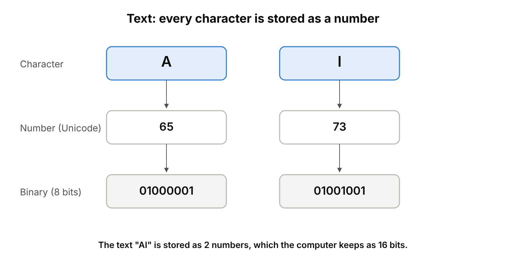

# 3. Text

> Text is a sequence of characters: letters, digits, spaces and symbols. To a computer, every character is a number.

## Introduction

When you read the word "AI" you see two letters. A computer cannot store letters, only numbers (see [binary](01-cpu.md)). So every character is given its own number, and the text is stored as a list of those numbers.

Text is the simplest kind of data to turn into numbers, which makes it a good place to start before images and video.

## What is it?

- **Text** is a **sequence of characters**.
- A **character** is one letter, digit, space, punctuation mark or symbol: `A`, `7`, `?`, `అ`.
- Every character has a **fixed number**, agreed on by all computers. This agreed table is called a **character encoding**.

| Character | Number |
|---|---|
| A | 65 |
| B | 66 |
| a | 97 |
| 0 | 48 |
| (space) | 32 |
| అ (Telugu) | 3077 |

Notice that `A` and `a` are different numbers, and that the digit `0` is stored as the number 48, not 0.

## Why is it needed?

- A computer can only store and compare numbers, so text has to become numbers before it can be saved, searched or sent.
- If two computers used different tables, the same numbers would show different letters. A shared standard avoids that.
- It is the first step for every language AI: an LLM can only read text after it has been turned into numbers.

## How does it work?

### ASCII and Unicode

| Standard | Characters covered | Example |
|---|---|---|
| **ASCII** | 128: English letters, digits and basic symbols | `A` = 65 |
| **Unicode** | Every language, plus symbols and emoji | `అ` = 3077, `A` = 65 |

ASCII came first and only covers English. **Unicode** extends it to every language in the world, and keeps the same numbers for the ASCII characters. Each language gets its own range: Telugu characters sit together in one block (`ఀ` to `౿`).

### From a number to bytes: UTF-8

The number then has to be stored as bytes. The most common way is **UTF-8**, which uses 1 to 4 bytes per character:

| Character | Bytes in UTF-8 |
|---|---|
| English letter (`A`) | 1 |
| Telugu letter (`అ`) | 3 |
| Emoji (`😀`) | 4 |

So the same number of characters can take a different amount of memory, depending on the language.

### Example: the word "AI"



### How does a computer process text?

1. **Text input:** typed on a keyboard, read from a file, or produced from speech
2. **Characters:** the text is split into individual characters
3. **Character → number:** each character is looked up in Unicode
4. **Number → bytes:** the numbers are stored as bytes (UTF-8), which are binary
5. **Text processing:** search, compare, translate, or feed to a model
6. **Display:** the numbers are turned back into letters on screen

### Text, image and video compared

| Data | Smallest unit | Stored as |
|---|---|---|
| Text | Character | One number per character |
| [Image](04-image.md) | Pixel | Three numbers (R, G, B) per pixel |
| [Video](06-video.md) | Frame | Many images per second |

## Flow diagram

```text
Text ("AI") → Characters (A, I) → Numbers (65, 73) → Binary (01000001 01001001)
```

## Real-world use cases

- Messages, documents and web pages
- Search (matching the numbers of what you typed)
- Supporting many languages in one app
- Input for language models ([NLP](09-nlp.md), [LLM](12-llm.md))

## In our project

**Used.** Text is the form everything passes through: the user's Telugu speech becomes Telugu text, the question is translated to English text when needed, the vehicle manuals are English text, and the answer is Telugu text before it is spoken.

| Where | How text as numbers shows up |
|---|---|
| **Telugu detection** | We count characters that fall in the Telugu Unicode range (`ఀ`–`౿`) to decide which lines of an answer are spoken: lines without Telugu are left out of the audio. See [NLP](09-nlp.md). |
| **Our own tokenizer** | Our Telugu model uses a character-level tokenizer: each of the 245 unique Telugu characters in the training text gets its own ID. See [Tokenization](34-tokenization.md). |

For an LLM, character numbers are only the starting point: text is regrouped into **tokens**, and each token gets its own ID. That step is covered in [Tokenization](34-tokenization.md).

---

**Previous:** [← GPU](02-gpu.md) · [Home](../README.md) · **Next:** [Image →](04-image.md)
