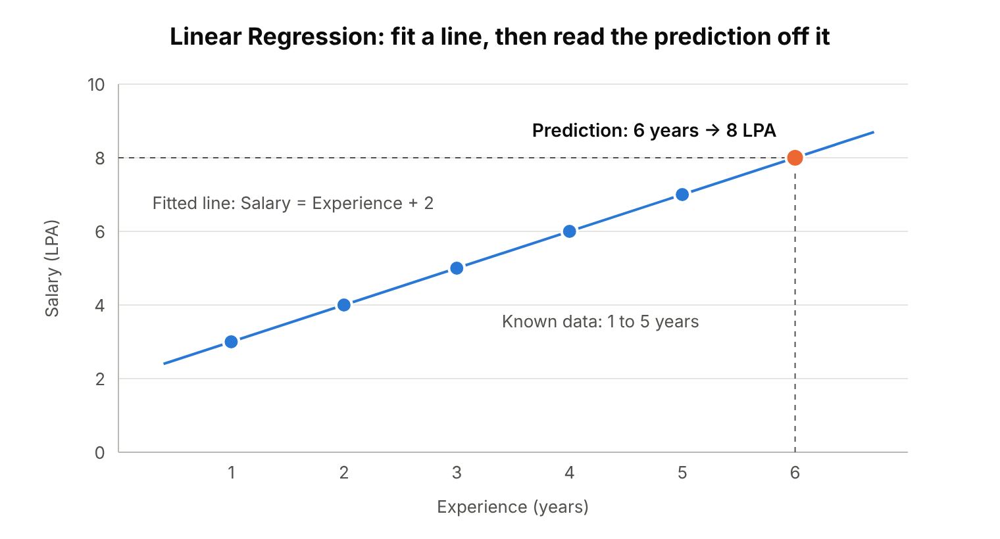

# 22. Linear Regression

> Linear Regression is a supervised learning regression algorithm used to predict a continuous numerical value.

## Introduction

This is the first of the classic ML **algorithms**. The earlier pages explained the *types* of learning; from here on, each page is one concrete algorithm. Linear Regression is the simplest, and the usual starting point.

## What is it?

**Linear Regression (LR)** is a [supervised learning](18-supervised-learning.md) **regression** algorithm. It is used to **predict a continuous numerical value** such as a salary, a price or a temperature.

### Example: experience and salary

Suppose you have this data:

| Experience (years) | Salary |
|---|---|
| 1 | 3 LPA |
| 2 | 4 LPA |
| 3 | 5 LPA |
| 4 | 6 LPA |
| 5 | 7 LPA |

(LPA = lakhs per annum, the yearly salary in lakhs of rupees.)

You can observe a pattern: as the years of experience increase, the salary increases. Linear Regression learns that pattern and uses it to find the salary for an employee who is not in the data:

```text
6 years of experience → 8 LPA
```



## Why is it needed?

- Many real questions have a number as the answer: "how much?", "how many?", "how long?".
- When the input and output move together in a steady way, a straight line describes the relationship well.
- It is simple, fast to train and easy to explain, so it is a good first model to try.

## How does it work?

1. Collect examples with an input and a known numerical output (experience → salary).
2. The algorithm fits the **straight line** that passes as close as possible to all the data points.
3. The line is described by `output = slope × input + intercept`.
4. For a new input, read the output off the line.

For the data above, the line is:

```text
Salary = 1 × Experience + 2

Experience = 6  →  Salary = 1 × 6 + 2 = 8 LPA
```

## Flow diagram

```text
Training data: Experience → Salary
        ↓
Fit the best straight line through the points
        ↓
New input (6 years)
        ↓
Predicted number (8 LPA)
```

## Real-world use cases

- Predicting salary from years of experience
- Predicting house prices from size
- Forecasting sales from advertising spend
- Estimating delivery time from distance

## In our project

**Not used yet.** Our voice assistant does not predict numerical values from data.

---

**Previous:** [← Reinforcement Learning](21-reinforcement-learning.md) · [Home](../README.md) · **Next:** [Logistic Regression →](23-logistic-regression.md)
