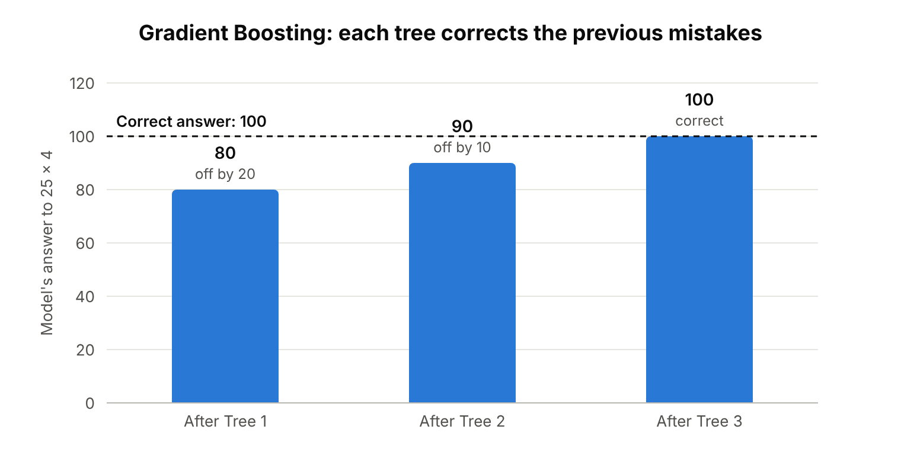

# 25. Gradient Boosting / XGBoost

> Gradient Boosting is an ML technique where multiple models work one after another, with each new model trying to correct the mistakes made by the previous models.

## Introduction

[Random Forest](24-random-forest.md) builds many trees that work independently. Boosting takes the opposite approach: the trees work **one after another**, and each one learns from the mistakes of the ones before it.

## What is it?

**Gradient Boosting (GB)** is an ML technique where **multiple models work one after another, with each new model trying to correct the mistakes made by the previous models**.

- Many trees work one after another to fix mistakes.
- **XGBoost** is a popular, fast implementation of gradient boosting.

### Example: learning maths

Imagine you are learning maths.

- The teacher asks: what is 25 × 4?
- Your answer: 80.
- The teacher says it is incorrect; the answer is 100.
- You understand the mistake and try again.
- Next time your answer is 90. The teacher says you are closer.
- You try again and reach 100.

This is the basic idea behind boosting: every attempt improves on the mistakes of the previous one.



## Why is it needed?

- A single small model is often not accurate enough.
- Focusing each new model on what is still wrong improves the result step by step.
- On table-style data (rows and columns), boosting is often among the most accurate methods.

## How does it work?

1. Train the first tree on the data.
2. Find its errors: where its predictions are wrong, and by how much.
3. Train the next tree to correct those errors.
4. Repeat; every new tree improves the result a little further.
5. The final prediction combines all the trees.

### Random Forest vs boosting

| | Random Forest | Gradient Boosting |
|---|---|---|
| How trees are built | Independently | One after another |
| What each tree does | Makes its own prediction | Corrects the previous trees' mistakes |
| Final prediction | Vote or average | Sum of all the trees' contributions |

## Flow diagram

```text
Data → Tree 1 → Find errors → Tree 2 (improves on errors) → Tree 3 (improves further) → ...
                                                                                         ↓
                                                                                 Final prediction
```

## Real-world use cases

- Credit scoring and fraud detection
- Predicting sales and demand
- Ranking search results
- Predicting which customers will leave

## In our project

**Not used yet.** We don't train boosted tree models.

---

**Previous:** [← Random Forest](24-random-forest.md) · [Home](../README.md) · **Next:** [KNN →](26-knn.md)
