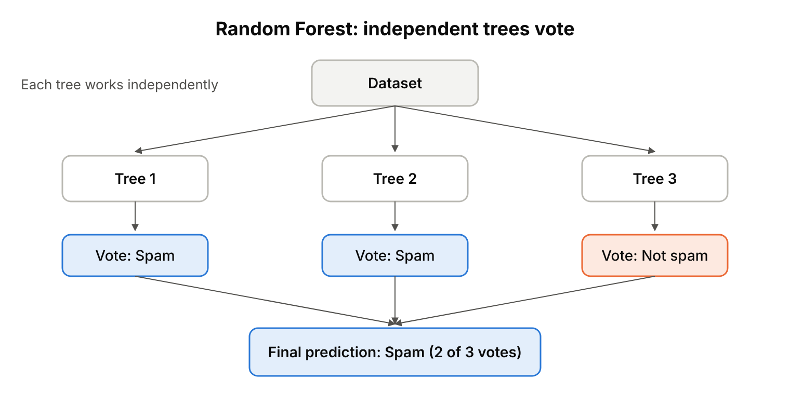

# 25. Random Forest

> Random Forest is a supervised learning algorithm that combines multiple Decision Trees to make a final prediction.

## Introduction

A single [Decision Tree](24-decision-tree.md) can make mistakes, in the same way one person's opinion can be wrong. Asking many trees and combining their answers gives a more reliable result.

## What is it?

**Random Forest (RF)** is a [supervised learning](18-supervised-learning.md) algorithm that **combines multiple Decision Trees to make a final prediction**.

- For **classification**, the trees **vote**.
- For **regression**, the predictions are **averaged**.
- The many trees work **independently** of each other.



## Why is it needed?

- One tree can learn its training examples too closely and then do badly on new data.
- Different trees make different mistakes; combining them cancels many of those mistakes out.
- The result is usually more accurate and more stable than a single tree.

## How does it work?

1. Start with one dataset.
2. Build many Decision Trees, each from a different random sample of the data, so every tree is slightly different.
3. Give a new input to every tree; each tree makes its own prediction independently.
4. Combine the predictions:

| Task | How the trees are combined | Example |
|---|---|---|
| **Classification** | Trees vote; the majority wins | Spam, Spam, Not spam → **Spam** |
| **Regression** | Predictions are averaged | 7, 8, 9 LPA → **8 LPA** |

## Flow diagram

```text
                Dataset
       ┌───────────┼───────────┐
       ↓           ↓           ↓
    Tree 1      Tree 2      Tree 3
       ↓           ↓           ↓
       └───────────┼───────────┘
                   ↓
          Combined prediction
```

## Real-world use cases

- Loan and credit risk scoring
- Fraud detection
- Predicting which customers will leave
- Disease prediction from patient data

## In our project

**Not used yet.** We don't train tree-based models.

---

**Previous:** [← Decision Tree](24-decision-tree.md) · [Home](../README.md) · **Next:** [Gradient Boosting / XGBoost →](26-gradient-boosting.md)
