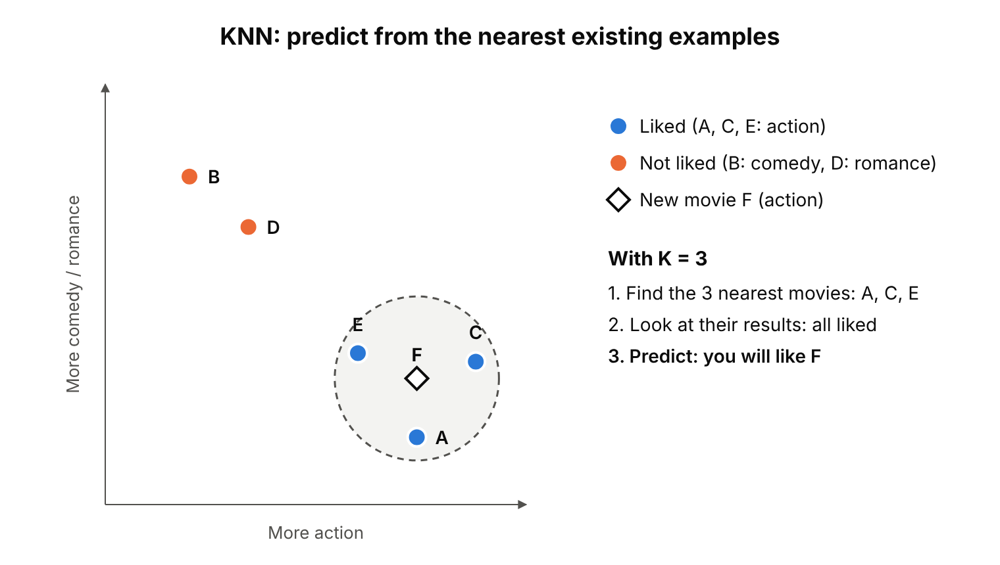

# 27. KNN (K-Nearest Neighbors)

> KNN is an ML algorithm that looks at the nearest existing examples and uses them to make a prediction.

## Introduction

To guess whether you will like something new, a good trick is to look at the most similar things you have already tried. KNN turns that idea into an algorithm.

## What is it?

**K-Nearest Neighbors (KNN)** is an ML algorithm that **looks at the nearest existing examples and uses them to make a prediction**.

It is a [supervised learning](18-supervised-learning.md) algorithm: the existing examples already have known results. **K** is the number of nearest examples it looks at.

### Example: will you like a new movie?

Imagine you want to watch a movie, and suppose you like action movies. Movies you have watched:

| Movie | Type | Result |
|---|---|---|
| A | Action | Liked |
| B | Comedy | Not liked |
| C | Action | Liked |
| D | Romance | Not liked |
| E | Action | Liked |

A new movie comes along; call it movie **F**. How can we predict whether you might like it?

KNN says: look at the movies that are similar to the new movie.

- The new movie F is an action movie.
- The most similar movies (A, C and E) were all liked by you.
- So KNN predicts you will probably like the new movie too.

That is the basic idea of KNN: it looks at the nearest examples and makes a prediction based on their results.



## Why is it needed?

- It is one of the simplest algorithms to understand.
- There is no separate training step: the stored examples are the model.
- It works for both classification (liked / not liked) and regression (predict a number).

## How does it work?

1. Store all the existing examples with their known results.
2. When a new item arrives, measure how similar it is to every stored example.
3. Pick the **K** nearest examples (the neighbours).
4. Combine their results: a majority vote for classification, an average for regression.

## Flow diagram

```text
New item (movie F: Action)
        ↓
Find the K most similar existing examples (A, C, E)
        ↓
Look at their results (Liked, Liked, Liked)
        ↓
Prediction: Liked
```

## Real-world use cases

- Movie and product recommendations
- Recognising handwritten digits
- Finding similar customers or patients
- Finding similar documents or images

## In our project

**Not used directly.** We don't train a KNN classifier.

A closely related idea powers our [RAG](14-rag.md) search: the user's question and the manual sections are turned into embeddings, and we pick the **nearest** section by distance. That is a nearest-neighbour search, but it retrieves text rather than predicting a category from the neighbours' labels.

---

**Previous:** [← Gradient Boosting / XGBoost](26-gradient-boosting.md) · [Home](../README.md) · **Next:** [K-Means →](28-k-means.md)
