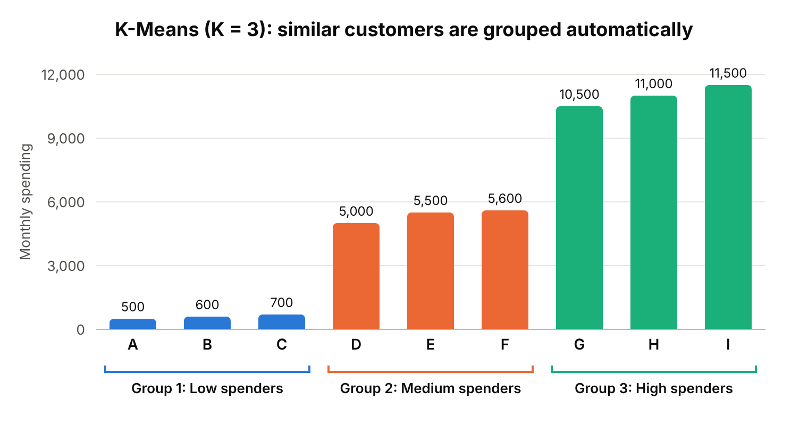

# 28. K-Means

> K-Means is an unsupervised learning algorithm that groups similar data points into K clusters based on their similarities.

## Introduction

The previous algorithm pages were all supervised: they learn from examples with known answers. K-Means is different. It is an [unsupervised learning](18-unsupervised-learning.md) algorithm, so it works on data that has no answers at all.

## What is it?

**K-Means** is an unsupervised learning algorithm that **groups similar data points into K clusters (K groups) based on similarities**.

> K-Means = group similar things together.

### Example: supermarket customers

Imagine you have a supermarket, and you have the monthly spending of your customers:

| Customer | Monthly spending | Group found |
|---|---|---|
| A | 500 | Low spenders |
| B | 600 | Low spenders |
| C | 700 | Low spenders |
| D | 5,000 | Medium spenders |
| E | 5,500 | Medium spenders |
| F | 5,600 | Medium spenders |
| G | 10,500 | High spenders |
| H | 11,000 | High spenders |
| I | 11,500 | High spenders |

- You want to divide the customers into 3 groups, but you don't know how.
- You give this information to K-Means, with K = 3.
- It automatically identifies similar customers and groups them.
- It discovers the groups by looking at the spending patterns. Nobody told it which customer belongs where.



## Why is it needed?

- Most data has no labels, so supervised algorithms cannot be used on it.
- Grouping by hand is slow and breaks down when there are thousands of customers.
- The groups it finds can be acted on: different offers for low, medium and high spenders.

## How does it work?

1. Choose **K**, the number of groups you want (here, 3).
2. The algorithm starts with K centre points.
3. Every data point is assigned to its nearest centre.
4. Each centre moves to the average of the points assigned to it.
5. Steps 3 and 4 repeat until the groups stop changing.

The "means" in the name are those averages.

## K-Means vs KNN

The names are similar, but the algorithms are not:

| | K-Means | [KNN](26-knn.md) |
|---|---|---|
| Type | Unsupervised | Supervised |
| Goal | Group similar data points | Predict the result for a new item |
| What K means | Number of groups | Number of nearest examples to look at |

## Flow diagram

```text
Data with no labels (customer spending)
        ↓
Choose K (3 groups)
        ↓
Assign each point to its nearest centre
        ↓
Move each centre to the average of its group  ⟲ repeat
        ↓
K groups (low / medium / high spenders)
```

## Real-world use cases

- Customer segmentation
- Grouping similar products or documents
- Reducing the number of colours in an image
- Grouping delivery locations into zones

## In our project

**Not used yet.** We don't cluster data.

---

**Previous:** [← Naive Bayes](27-naive-bayes.md) · [Home](../README.md) · **Next:** [DL →](29-dl.md)
