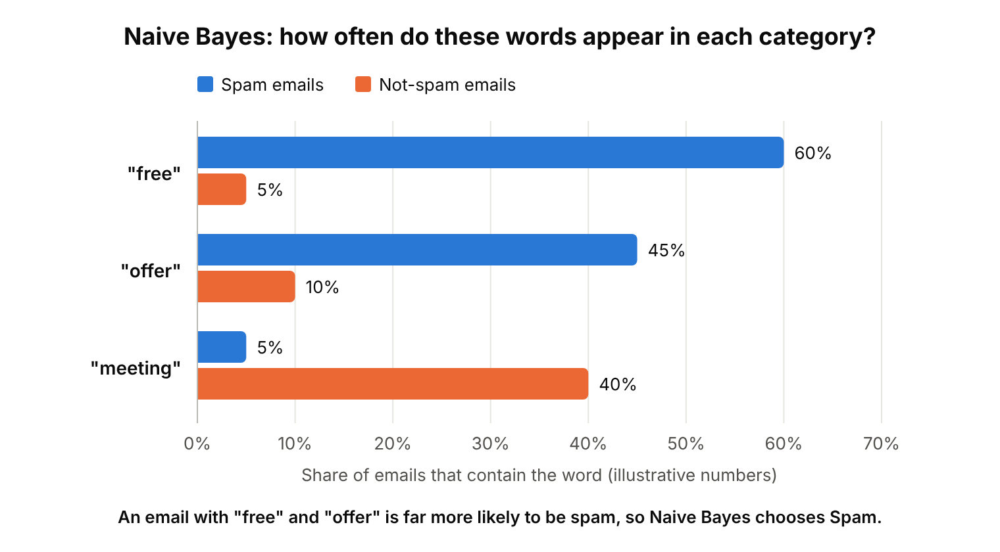

# 28. Naive Bayes

> Naive Bayes is a supervised learning algorithm that uses probability to predict which category something belongs to, based on the information available.

## Introduction

Naive Bayes is a classification algorithm, like [Logistic Regression](23-logistic-regression.md). Both predict a category; they differ in how they arrive at the probability.

## What is it?

**Naive Bayes (NB)** is a [supervised learning](18-supervised-learning.md) algorithm that **uses probability to predict which category something belongs to, based on the information available**.

- It is similar to Logistic Regression and is used for classification.
- Both predict a category, for example:
  1. spam / not spam
  2. positive / negative

Naive Bayes looks at the available features and calculates the probability for each category.

It is called "naive" because it treats every feature as independent of the others, which keeps the calculation simple.

## Why is it needed?

- It is very fast and works even with a small amount of training data.
- It suits text well, where the features are the words themselves.
- It gives a probability for every category, not only the final answer.

## How does it work?

For an email, Naive Bayes:

1. Checks the words in the email.
2. Checks how frequently those words appear in spam and in not-spam emails.
3. Calculates the probability of each category.
4. Chooses the category with the highest probability.



### Naive Bayes vs Logistic Regression

Logistic Regression also looks at the available features. For an email it looks at the number of suspicious words, links and sender information.

| | Naive Bayes | Logistic Regression |
|---|---|---|
| Used for | Classification | Classification |
| Looks at | Available features (e.g. the words) | Available features (e.g. suspicious words, links, sender info) |
| How it gets the probability | Bayes' probability, from how often features appear in each category | Weights learned during training |

```text
Naive Bayes:          Information → Bayes' probability → Prediction
Logistic Regression:  Information → Learned weights → Probability → Prediction
```

## Flow diagram

```text
New email
        ↓
Words in the email
        ↓
How often do these words appear in spam / not-spam emails?
        ↓
Probability of each category
        ↓
Choose the category with the highest probability
```

## Real-world use cases

- Spam filtering
- Sentiment analysis (positive / negative reviews)
- Sorting news articles or documents by topic
- Routing support tickets to the right team

## In our project

**Not used yet.** We don't train a probability-based classifier.

---

**Previous:** [← KNN](27-knn.md) · [Home](../README.md) · **Next:** [K-Means →](29-k-means.md)
