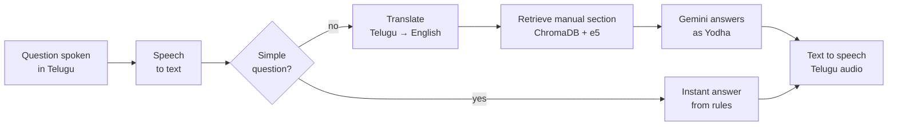
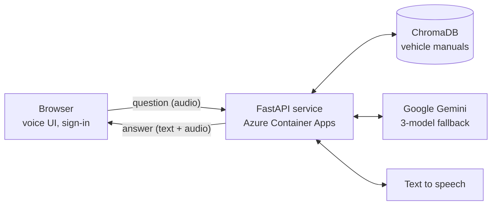
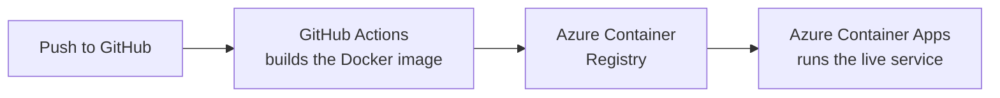

<div align="center">

# Yodha: Telugu Voice AI Assistant

**Ask a vehicle question out loud in Telugu and hear the answer in Telugu, grounded in the vehicle manuals.**

[](https://telugu-voice-app.gentletree-f4002f64.southindia.azurecontainerapps.io/assistant)
[](https://telugu-voice-app.gentletree-f4002f64.southindia.azurecontainerapps.io/openapi.json)


[**Open the live assistant**](https://telugu-voice-app.gentletree-f4002f64.southindia.azurecontainerapps.io/assistant) · [Implementation & Source Code → Tiny LLM on NVIDIA Jetson](https://github.com/SEVT-Logistics-Private-Limited/tiny-llm-jetson) · [How it works](#how-it-works) · [API](#api)


</div>

> [!NOTE]
> **Status: live in production.** Yodha runs on Azure Container Apps, is redeployed automatically from GitHub on every push, and requires sign-in. The status badges above read the live service directly.

## Executive summary

| Area | Summary |
|---|---|
| **Challenge** | Vehicle manuals are long, written in English and text-only, so answers are slow to find for Telugu speakers. |
| **Solution** | Yodha listens to a question in Telugu, finds the relevant section of the vehicle manual, has a large language model (LLM) answer from that section, and speaks the answer back in Telugu. |
| **Trust** | Answers are grounded in the manual rather than the model's memory: a relevance threshold on retrieved text, explicit "don't make things up" rules, a check that replies are in Telugu, and a three-model fallback if the primary LLM is unavailable. |
| **Production readiness** | A live web service on Azure with sign-in, strict HTTP security headers, automated build and deployment from GitHub, and endpoints that report service health and knowledge-base status. |
| **In-house capability** | A small Telugu language model built from scratch, developing LLM expertise beyond calling external APIs. |

## Key capabilities

- **Voice in, voice out, in Telugu.** Speech to text, a Telugu answer, then text to speech.
- **Answers grounded in the manuals.** Retrieval-augmented generation (RAG): manuals are indexed in ChromaDB with e5 embeddings, and the best-matching section is used only when it is relevant enough.
- **Instant answers for simple questions.** Rules answer simple questions without calling the LLM.
- **Conversation memory.** The last 8 messages are included with each question, so follow-ups work.
- **Streaming.** Text answers can stream back as they are generated.
- **Secure by default.** Sign-in, a strict Content-Security-Policy, HTTP Strict Transport Security and clickjacking protection.
- **Observable.** `GET /healthz` reports that the service is up; `GET /` reports the version and whether the manual knowledge base is loaded.

## How it works



| Step | What happens | Technology |
|---|---|---|
| 1. Speech to text | Telugu speech becomes Telugu text | Speech recognition |
| 2. Simple question? | Simple questions are answered immediately by rules | Rule engine |
| 3. Translate | The question is translated to English, the language of the manuals | [LLM](../../docs/12-llm.md) |
| 4. Retrieve | The best-matching manual section is found, if it is relevant enough | [RAG](../../docs/14-rag.md): ChromaDB, e5 embeddings |
| 5. Answer | Gemini answers in Telugu from that section, in the role of "Yodha" | [LLM](../../docs/12-llm.md), [Prompt Engineering](../../docs/32-prompt-engineering.md) |
| 6. Text to speech | The Telugu answer becomes audio | gTTS |

## Architecture and deployment



Every push to GitHub ships automatically:



The manual knowledge base is a ChromaDB volume attached to the container. After each deployment, and before any demo, check that `GET /` reports `"kb": "loaded"`; `"kb": "disabled"` means retrieval is off and answers are not grounded in the manuals.

## API

A REST API built with [FastAPI](../../docs/16-fastapi.md). Version 10.1 exposes 12 endpoints; the main ones:

| Method | Endpoint | Purpose |
|---|---|---|
| POST | `/auth/login` | Sign in |
| GET | `/assistant` | The voice assistant web app |
| POST | `/converse` | Voice question → answer as text and audio |
| POST | `/converse_text_stream` | Text question → answer streamed step by step |
| POST | `/tts` | Text → Telugu speech |
| GET | `/healthz` | Service health |
| GET | `/` | Version and knowledge-base status |

The others are `/converse_stream`, `/voice`, `/speak`, `/feedback` and `/debug`. The full machine-readable specification is published at [`/openapi.json`](https://telugu-voice-app.gentletree-f4002f64.southindia.azurecontainerapps.io/openapi.json).

## Technology stack

| Layer | Technology |
|---|---|
| Interface | Browser voice UI with sign-in |
| API | Python, FastAPI (Pydantic validation, streaming) |
| Knowledge | ChromaDB vector database, e5 embeddings |
| Language model | Google Gemini, with a three-model fallback chain |
| Speech | Speech recognition; gTTS text to speech |
| Infrastructure | Docker, GitHub Actions, Azure Container Registry, Azure Container Apps (CPU) |

## In-house Telugu language model

Alongside the production assistant, a small Telugu language model was built from scratch to understand how LLMs work internally.

| Setting | Value | Meaning |
|---|---|---|
| Transformer layers | 8 | Each layer refines the output of the one before |
| Attention heads | 8 | Eight attention operations run in parallel |
| Context length | 128 tokens | The most text the model reads at once |
| Vocabulary | 245 tokens | One token per Telugu character |
| Training | Batch 16, 10,000 steps | On a Jetson Orin Nano and a Colab A100, in 16-bit (bf16) precision |

Experiments covered models from 984 parameters up to 3 billion. See [Transformers](../../docs/31-transformers.md) and [Tokenization](../../docs/34-tokenization.md).

## Scope and limitations

- **Knowledge source.** Answers come from the indexed vehicle manuals, which are in English; each Telugu question is translated for retrieval.
- **One section per answer.** Retrieval uses the single best-matching section, and only if its similarity distance is 0.35 or less.
- **Knowledge base dependency.** If the ChromaDB volume is not attached, retrieval is disabled; `GET /` reports this.
- **CPU hosting.** The live service, including the embedding model, runs on CPU-only cloud machines.

## Topics covered in this project

This project applies 14 of the 34 topics in [My AI Engineering Journey](../../README.md). Each topic page has an **"In our project"** section with details.

<details>
<summary>Show all 34 topics and how they connect</summary>

| # | Topic | Used? | How we used it |
|---|---|---|---|
| 1 | [CPU](../../docs/01-cpu.md) | Yes | The live server runs on CPU-only cloud machines (Azure), including the embedding model; audio sent as binary → base64 in JSON |
| 2 | [GPU](../../docs/02-gpu.md) | Yes | Trained our models on a Jetson Orin Nano and a Colab A100; 16-bit (bf16) numbers to halve memory; up to ~100% of GPU memory for the largest models |
| 3 | [Text](../../docs/03-text.md) | Yes | Telugu and English text throughout; Telugu Unicode range for script detection; one token per Telugu character |
| 4 | [Image](../../docs/04-image.md) | Not yet | Not used yet |
| 5 | [Image Resolution](../../docs/05-image-resolution.md) | Not yet | Not used yet |
| 6 | [Video](../../docs/06-video.md) | Not yet | Not used yet |
| 7 | [Frame](../../docs/07-frame.md) | Not yet | Not used yet |
| 8 | [FPS](../../docs/08-fps.md) | Not yet | Not used yet |
| 9 | [NLP](../../docs/09-nlp.md) | Yes | Telugu speech-to-text, keyword matching, translation, text cleanup, Telugu-script detection |
| 10 | [VLM](../../docs/10-vlm.md) | Not yet | Not used yet |
| 11 | [VLA](../../docs/11-vla.md) | Not yet | Not used yet |
| 12 | [LLM](../../docs/12-llm.md) | Yes | Gemini with a 3-model fallback chain; our own GPT models from 984 parameters to 3B |
| 13 | [ROS](../../docs/13-ros.md) | Not yet | Not used yet |
| 14 | [RAG](../../docs/14-rag.md) | Yes | Vehicle manuals in ChromaDB, e5 embeddings, top-1 chunk if distance ≤ 0.35 |
| 15 | [API](../../docs/15-api.md) | Yes | Our own REST endpoints; we call the Gemini and gTTS APIs |
| 16 | [FastAPI](../../docs/16-fastapi.md) | Yes | The server: Pydantic validation, streaming (SSE), automatic API specification |
| 17 | [ML](../../docs/17-ml.md) | Yes | Rules for simple questions, learned models for everything else |
| 18 | [Supervised Learning](../../docs/18-supervised-learning.md) | Not directly | No classic classifier or regression model; our language models are self-supervised (predict the next character) |
| 19 | [Unsupervised Learning](../../docs/19-unsupervised-learning.md) | Not yet | Not used yet |
| 20 | [Semi-Supervised Learning](../../docs/20-semi-supervised-learning.md) | Not yet | Not used yet |
| 21 | [Reinforcement Learning](../../docs/21-reinforcement-learning.md) | Not yet | Not used yet |
| 22 | [Linear Regression](../../docs/22-linear-regression.md) | Not yet | Not used yet |
| 23 | [Logistic Regression](../../docs/23-logistic-regression.md) | Not yet | Not used yet |
| 24 | [Decision Tree](../../docs/24-decision-tree.md) | Not yet | Not used yet |
| 25 | [Random Forest](../../docs/25-random-forest.md) | Not yet | Not used yet |
| 26 | [Gradient Boosting / XGBoost](../../docs/26-gradient-boosting.md) | Not yet | Not used yet |
| 27 | [KNN](../../docs/27-knn.md) | Not directly | No KNN classifier; RAG retrieval is a related nearest-neighbour search (closest chunk by embedding distance) |
| 28 | [K-Means](../../docs/28-k-means.md) | Not yet | Not used yet |
| 29 | [Naive Bayes](../../docs/29-naive-bayes.md) | Not yet | Not used yet |
| 30 | [DL](../../docs/30-dl.md) | Yes | Trained the Telugu model: batch 16, 10,000 steps, loss 331 → 1.42 |
| 31 | [Transformers](../../docs/31-transformers.md) | Yes | Our Telugu Transformer (8 layers, 8 heads, 128 context), e5 encoder, Gemini decoder |
| 32 | [Prompt Engineering](../../docs/32-prompt-engineering.md) | Yes | "Yodha" role prompt with rules, time, manual text and the last 8 messages |
| 33 | [Hallucination](../../docs/33-hallucination.md) | Yes | "Don't imagine" rules, RAG, relevance threshold, Telugu output check |
| 34 | [Tokenization](../../docs/34-tokenization.md) | Yes | Character tokenizer (245 Telugu tokens); output-token limits on Gemini |

How the topics connect inside the assistant:

```text
User speaks (NLP: speech to text)
        ↓
Browser → our REST API (API, FastAPI; audio sent as base64)
        ↓
Simple question? → rules → instant answer (ML vs rules)
        ↓ no
RAG: embeddings + ChromaDB (RAG, Transformers: e5 encoder)
        ↓
Prompt: Yodha role + rules + manual text (Prompt Engineering, Hallucination)
        ↓
Gemini generates the answer (LLM, Tokenization: token limits)
        ↓
Clean text → speech → user hears it (NLP)

Behind the scenes: our own Telugu model trained on a GPU (GPU, DL, Transformers, Tokenization)
                   live server runs on Azure CPUs (CPU)
```

</details>

## Resources

| Resource | Purpose |
|---|---|
| [Live assistant](https://telugu-voice-app.gentletree-f4002f64.southindia.azurecontainerapps.io/assistant) | Try Yodha (sign-in required) |
| [API specification](https://telugu-voice-app.gentletree-f4002f64.southindia.azurecontainerapps.io/openapi.json) | Machine-readable OpenAPI description of every endpoint |
| [Implementation & Source Code → Tiny LLM on NVIDIA Jetson](https://github.com/SEVT-Logistics-Private-Limited/tiny-llm-jetson) | Application, deployment and model-training code |
| [RAG](../../docs/14-rag.md), [LLM](../../docs/12-llm.md), [Hallucination](../../docs/33-hallucination.md) | The concepts behind the assistant, explained |

## Author and contact

**Rishi Sasanala** · [rishisasanala@gmail.com](mailto:rishisasanala@gmail.com) · Yodha AI, SEVT Logistics Private Limited · part of [My AI Engineering Journey](../../README.md)
