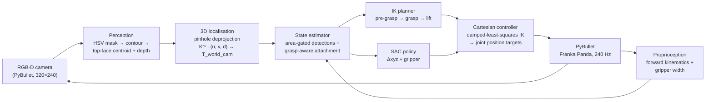

<div align="center">

# Vision-RL Pick-and-Place

**A Franka Panda that finds a cube with an RGB-D camera and picks it up, using a classical Vision + IK pipeline and a reinforcement-learning policy trained on CPU.**


-7c3aed)


 

*Left: learned SAC policy acting on camera estimates. Right: classical Vision + IK baseline.*

</div>

---

## Results

Test seeds 30000–30099 were evaluated **once, after development was frozen**. They were never used for training, checkpoint selection or debugging. Each episode places the cube at a random position in a 25 × 40 cm workspace.

| Controller | Object position from | Success (100 episodes) |
|---|---|---|
| Vision + IK baseline | Camera | **100%** (100/100) |
| SAC policy | Simulator ground truth (as trained) | **99%** (99/100) |
| SAC policy | **Camera + state estimator** | **99%** (99/100) |
| SAC policy, cube yaw ±45° (never seen in training) | Simulator ground truth | **100%** (100/100) |

| Perception metric (100 placements vs ground truth) | Value |
|---|---|
| 3D localisation error, top face | 1.8 mm mean · 2.8 mm max |
| Yaw error | 0.5° mean · 3.8° max |
| Detection rate, unoccluded | 100 / 100 |

**Training:** SAC, 60 000 environment steps, 18 minutes on a 4-core CPU, no GPU. Validation success first reaches 100% at 25 000 steps and stays there from 40 000; the saved policy is the best validation checkpoint (40 000).

**Reproducibility:** every episode is a pure function of its seed (see [engineering log](#engineering-log), item 4), so `python scripts/evaluate.py` reproduces these numbers on the same PyBullet build.

<picture>
  <source media="(prefers-color-scheme: dark)" srcset="assets/training_curve_dark.png">
  
</picture>

<details>
<summary>Training curve data (20 validation episodes per point)</summary>

| Training steps | Success rate | Mean episode length | Mean return |
|---|---|---|---|
| 5,000 | 0% | 100.0 | -114.20 |
| 10,000 | 0% | 100.0 | -84.34 |
| 15,000 | 0% | 100.0 | -84.02 |
| 20,000 | 85% | 26.6 | -17.41 |
| 25,000 | 100% | 12.8 | -1.51 |
| 30,000 | 100% | 14.3 | -2.58 |
| 35,000 | 95% | 16.1 | -4.71 |
| 40,000 (saved) | 100% | 11.3 | -0.29 |
| 45,000 | 100% | 11.8 | -0.71 |
| 50,000 | 100% | 11.7 | -0.78 |
| 55,000 | 100% | 11.4 | -0.32 |
| 60,000 | 100% | 11.7 | -0.60 |

Regenerate the chart from any run with `python scripts/plot_training.py --run runs/<name>`. The values are also in [`assets/training_curve.csv`](assets/training_curve.csv).

</details>

| Seeds | Used for |
|---|---|
| 0 (one stream) | training episodes |
| 1000 (one stream) | validation during training: picks the saved checkpoint |
| 10000+, 20000+ | development: debugging perception and determinism |
| **30000–30099** | **test: the numbers above** |

## Architecture



Both controllers share the same perception and the same low-level Cartesian controller. Only the decision layer differs, so their results are directly comparable.

### Design decisions

| Decision | Why |
|---|---|
| **Perception consumes only `(rgb, depth, K, T_world_cam)`** | Same interface as a RealSense/ZED driver, so the module transfers to hardware unchanged. |
| **Top-face depth gating** | Perspective makes the cube's side faces visible and biases the centroid. Keeping only pixels within 1 cm of the nearest surface cut the mean error from 3.3 mm to 1.8 mm (max 6.1 → 2.8 mm). |
| **Yaw measured in the world frame** | The min-area rectangle edge is deprojected to 3D before taking `atan2`, so no camera-mounting convention is hard-coded. |
| **RL acts in Cartesian space (Δxyz + gripper)** | A 4-D action through IK is far more sample-efficient than 9-D joint control, which is what makes CPU-only training feasible. |
| **Train on ground truth, evaluate on perception** | Rendering a camera frame costs ~50 ms vs ~1.5 ms per physics step. Evaluating on perceived state measures the estimation gap explicitly instead of hiding it. |
| **State estimator fuses camera and proprioception** | The camera alone fails once the arm is in view. Encoders and gripper width exist on any real arm, so the estimator uses no simulator state. |
| **Fresh physics world every episode** | Moving bodies directly leaves solver caches behind, which made results depend on episode order. A rebuild costs 60 ms. |
| **Reward always uses true state** | The reward is a training signal, not a policy input, so it should not inherit perception noise. |
| **Config rejects rewards that allow hovering** | The step penalty must exceed the best per-step shaping reward, or the agent learns never to finish. This is checked at load time. |
| **Typed, validated YAML config** | Unknown or missing keys fail at load time; no silent defaults. |

## Engineering log

What broke during development, how it was found, and what fixed it. Each fix is covered by a test.

| # | Symptom | Root cause | Fix | Effect |
|---|---|---|---|---|
| 1 | Evaluation reward rose during training, but success stayed at 0% | **Reward hacking.** Holding the cube just below the success height collected grasp and lift bonuses every step, worth ~15 discounted, more than the one-time +10 success bonus. | A constant step penalty larger than the best per-step shaping reward, enforced by config validation | 0% → 85% success at 20k steps, 100% at 25k |
| 2 | Policy: 100% with ground truth, **21%** with the camera | (a) The estimate stayed at the table while the cube was lifted, so the policy kept re-grasping. (b) Detections of a partly hidden cube (42 px of 330) were accepted, giving biased positions. | `ObjectStateEstimator`: trust a detection only if its blob is ≥ 80% of the unoccluded area; while the cube is held, move its estimate with the hand (forward kinematics) | 21% → 98% on development seeds |
| 3 | Estimate dragged 6 cm away during a failed grasp | **False attachment.** A corner pinch (width 0.65 × cube size) counted as a grasp. | Hold band from cube geometry: face-to-face (1.0×) to across the diagonal (√2×). Attach only once the fingers are still for two frames. | 98% → 100% on development seeds |
| 4 | Same seed, different outcome | **Non-deterministic resets.** Bullet keeps solver and contact caches across resets; `saveState`/`restoreState` did not clear them (verified). Trajectories diverged by up to 6 cm depending on the previous episode. | Rebuild the physics world each episode | Bit-identical rollouts per seed; regression test |
| 5 | Wrist reached only ~55% of the commanded yaw | IK null-space rest pose pinned joint 7 at neutral, and convergence checked position only | Bias the rest pose by the target yaw; require orientation convergence | Yaw error < 3° |

One rule was **removed**: a check that let a partial detection override a stale estimate. It fired 0 times in 100 development episodes, so it added complexity without measured benefit.

## Quickstart

```bash
git clone https://github.com/SEVT-Logistics-Private-Limited/My-AI-Engineering-Journey.git
cd My-AI-Engineering-Journey/projects/vision-rl-pickplace
python -m venv .venv && source .venv/bin/activate
pip install torch --index-url https://download.pytorch.org/whl/cpu   # CPU build, ~200 MB
pip install -r requirements.txt
```

```bash
python scripts/detect_object.py --trials 10          # Phase 1: camera → 3D position
python scripts/run_baseline.py --episodes 20         # Phase 2: Vision + IK pick-and-place
python scripts/evaluate.py --controller rl           # Phase 3: trained policy, test seeds
python scripts/evaluate.py --controller rl --obs-source perception
python scripts/train_rl.py                           # retrain from scratch (~18 min on 4 CPU cores)
python scripts/plot_training.py --run runs/<name>    # validation curve → assets/ (light + dark PNG, CSV)
tensorboard --logdir runs/
pytest -q                                            # 45 tests, ~10 s
```

Add `--gui` to `run_baseline.py` to watch in the PyBullet window, `--video out.gif` or `--video out.mp4` to `evaluate.py` to record, or `--min-success 0.9` to make `evaluate.py` fail below a success rate (used in CI).

## The RL task

| | |
|---|---|
| **Observation (10)** | end-effector xyz · gripper width · object xyz · object − end-effector |
| **Action (4)** | Δx, Δy, Δz ∈ [−1, 1] × 3 cm · gripper (> 0 closes) |
| **Reward** | −1 per step · −‖ee − object‖ (reach) · +0.25 while both fingers touch (grasp) · +10 × lift height, capped at 5 cm (lift) · +10 on success |
| **Termination** | success (grasped and lifted ≥ 5 cm) or 100 steps (~4 s at 24 Hz) |
| **Reset** | fresh physics world; cube at a random position; gripper starts 15–25 cm above a random point in the workspace |

A hand-written scripted expert solves the task through the same action API (tested in `tests/test_env.py`). That separates "is the environment solvable?" from "did the agent learn?", which is the first thing to rule out when RL fails.

## Repository layout

```text
vision-rl-pickplace/
├── config/default.yaml        Simulation, camera, perception, grasp and RL settings
├── src/pickplace/
│   ├── config.py              Typed + validated config loading
│   ├── sim.py                 PyBullet scene: Panda, cube, contacts, deterministic reset
│   ├── camera.py              RGB-D camera with explicit intrinsics/extrinsics
│   ├── perception.py          Detection, 3D deprojection, yaw, state estimator
│   ├── kinematics.py          IK + Cartesian control of the Panda
│   ├── pipeline.py            Classical Vision → IK → grasp baseline
│   ├── env.py                 Gymnasium environment (PickLift-v0)
│   ├── utils.py               Transform helpers
│   └── video.py               GIF / MP4 writer
├── scripts/
│   ├── detect_object.py       Phase 1 milestone
│   ├── run_baseline.py        Phase 2 milestone
│   ├── train_rl.py            Phase 3: SAC / PPO training
│   ├── evaluate.py            Success rates, video recording, CI gate
│   └── plot_training.py       Validation curve chart (light/dark) + CSV
├── models/sac_picklift.zip    Trained policy (best validation checkpoint)
├── tests/                     45 tests: config, perception, estimator, IK, baseline, env, determinism, video, plotting
└── assets/                    GIFs, training curve (PNG + CSV), debug images
```

## Limitations and future work

- **Single, uniquely coloured object under fixed lighting.** HSV thresholding is the weakest link for the real world. Next step: a learned detector or instance segmentation, then point-cloud grasp pose estimation for clutter.
- **Hidden displacement.** If the hand knocks the cube while the arm fully hides it from the overhead camera, the estimate cannot recover until the cube is visible again. This is the camera-mode test failure (seed 30056: cube pushed 3.9 cm, estimate 37 mm off). A wrist camera or a second viewpoint would close the gap.
- **Rare policy stall.** In the ground-truth test failure (seed 30023), the policy held a tilted cube for 92 steps but hovered instead of lifting. More varied grasp starts during training, or a reward term for lift progress, would target this.
- **No wrist rotation in the policy.** The policy still picks up rotated cubes (±45°, never seen in training) because the 8 cm gripper opening is wider than the cube's 5.7 cm diagonal, so closing the fingers aligns it. Elongated objects would need a yaw action.
- **State-based RL.** The policy sees an estimated 3D position, not pixels. Visual RL (an image encoder with data augmentation, e.g. DrQ) would remove the hand-designed perception stage at a much higher sample cost.
- **No domain randomisation.** Friction, mass, camera pose and lighting are fixed, so sim-to-real transfer is untested. Randomising them during training is required before hardware.
- **Pick-and-lift, not place.** A goal position (goal-conditioned policy with Hindsight Experience Replay) would extend this to full pick-and-place.
- **Determinism is per build.** Episodes are bit-identical on a given PyBullet build, but different builds (for example a source build vs a prebuilt wheel) can differ numerically.

## Related topics in this repository

[VLA](../../docs/11-vla.md) · [ROS](../../docs/13-ros.md) · [Reinforcement Learning](../../docs/21-reinforcement-learning.md) · [Image](../../docs/04-image.md) · [Image Resolution](../../docs/05-image-resolution.md)
