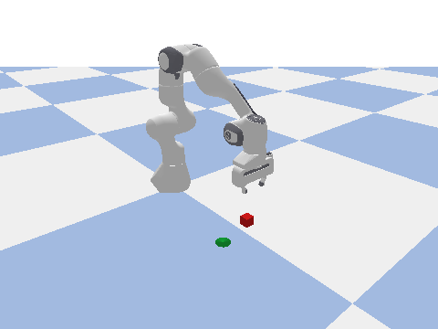
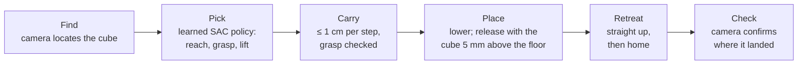
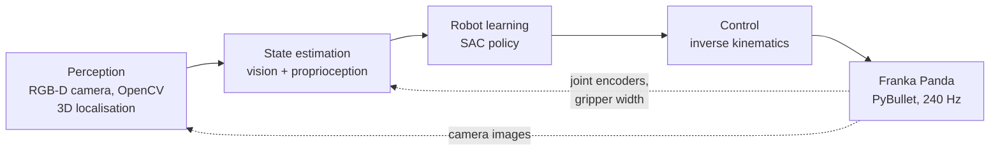
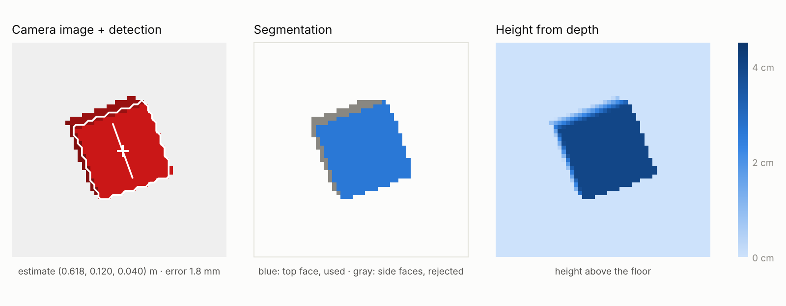

<div align="center">

# Vision-RL Pick-and-Place

**Computer vision and robot learning for robotic pick-and-place.** A simulated Franka Panda robot arm finds a cube on the floor with a depth camera, keeps tracking it even when its own arm hides it, picks it up with a control policy learned by reinforcement learning on a standard CPU, and sets it back down at a different spot on the floor.

[](https://github.com/SEVT-Logistics-Private-Limited/My-AI-Engineering-Journey/actions/workflows/vision-rl-pickplace.yml)


 

*Left: learned SAC pick, acting on camera estimates, then the carry and place onto the green goal. Right: classical Vision + IK baseline. Real time, 24 fps.*

**100%** pick-and-place success from the camera · **4.4 mm** mean placement error · **99%** learned-pick success · **1.8 mm** 3D localisation error · **18 min** training on a 4-core CPU · **122** tests in CI

</div>

---

> [!NOTE]
> **Status: research prototype.** Developed and evaluated in a physics simulator (PyBullet); not yet tested on a physical robot. The path to hardware is in the [roadmap](#limitations-and-roadmap).

## Executive summary

| Area | Summary |
|---|---|
| **Challenge** | To move an object, a robot must see it, locate it precisely, grasp it reliably (including when its own arm hides it from the camera), carry it without dropping it, and set it down where it belongs. |
| **Solution** | A complete perception-to-action software stack, built and tested in simulation: computer vision locates the cube from a depth camera, a state estimator keeps tracking it through occlusion, a control policy trained by reinforcement learning picks it up, a slip-free carry sets it down at a goal spot elsewhere on the floor, and the camera confirms where it landed. |
| **Results** | 100% pick-and-place success from camera input on 100 held-out test episodes, 4.4 mm mean placement error; the learned pick alone succeeds 99% of the time from the camera and 100% on cube orientations never seen in training; 1.8 mm localisation error. |
| **Efficiency** | The pick policy trains in 18 minutes on a standard 4-core CPU, with no GPU and no robot hardware. |
| **Why it matters** | Pick-and-place is a core step in warehouse and logistics automation. This prototype demonstrates, without any robot hardware, the software such systems need: perception, tracking, learned control, motion planning and rigorous testing. |
| **Quality** | Every result is reproducible from its seed; 122 automated tests and continuous-integration gates on the trained policy and the full pick-and-place pipeline guard against regressions. |

## Contents

[Results](#results) · [How it works](#how-it-works) · [Engineering challenges](#engineering-challenges) · [End-to-end RL](#end-to-end-rl-not-solved-yet) · [Skills demonstrated](#skills-demonstrated) · [Key design decisions](#key-design-decisions) · [Quickstart](#quickstart) · [Testing and CI](#testing-and-ci) · [Project structure](#project-structure) · [Limitations and roadmap](#limitations-and-roadmap) · [Topics covered](#topics-covered-in-this-project) · [Resources](#resources)

## Results

All numbers come from **100 held-out test episodes** (seeds 30000–30099). In each one the cube starts at a random spot on the floor of a 25 × 40 cm workspace and a goal spot is drawn at least 13 cm away. These seeds were evaluated once, after development was frozen, and every controller is scored by the same [success rule](#6-success-rule).

### Pick and place

| Controller | Object position from | Success | Placement error, mean (max) |
|---|---|---|---|
| Learned pick + scripted place | **Camera + state estimator** | **100%** (100/100) | 4.4 mm (14.1 mm) |
| Learned pick + scripted place | Simulator ground truth | **100%** (100/100) | 5.2 mm (21.4 mm) |
| Vision + IK baseline (scripted pick and place) | Camera | **100%** (100/100) | 3.2 mm (7.7 mm) |

| Out of distribution | Baseline | Learned pick + scripted place |
|---|---|---|
| Goals within 2 cm of the goal region's edge | 100% | 100% |
| Cube rotated up to ±45° (the pick policy trained at 0°) | – | 98%: 2 toppled |

- **Failure breakdown:** 2 failures in 600 test episodes, both `toppled` with the cube rotated: the policy does not turn the wrist, so a rotated cube can be held across its diagonal, and released, it settles on an edge (tilt ≈ 54°).
- **Placement error** comes mostly from where the cube sits between the finger pads after the pick, which the hand cannot sense. The baseline's carry only translates it, so for the baseline a seed gives the same error with any goal.
- **Camera check:** with the arm back home, the photo agrees with the true position to about 1.8 mm on average.
- The edge band was tightened from 5 cm to 2 cm after a first run showed that most 5 cm "edge" goals were ordinary goals (two thirds of the region qualified); the controllers did not change.

### The learned pick

 

*The pick stage on its own. Left: learned SAC policy acting on camera estimates. Right: classical Vision + IK baseline.*

The pick stage succeeds when the cube is held and lifted at least 5 cm, the first condition of the full success rule. Benchmarked on its own over the same test seeds:

| Controller | Object position from | Success rate |
|---|---|---|
| Vision + IK baseline | Camera | **100%** (100/100) |
| SAC policy | Simulator ground truth (as trained) | **99%** (99/100) |
| SAC policy | **Camera + state estimator** | **99%** (99/100) |
| SAC policy, cube rotated ±45° (unseen in training) | Simulator ground truth | **100%** (100/100) |

| Perception (100 placements vs ground truth) | Result |
|---|---|
| 3D localisation error, top face | 1.8 mm mean · 2.8 mm max |
| Yaw error | 0.5° mean · 3.8° max |
| Detection rate, unoccluded | 100% |

Reproduce any row with `scripts/evaluate.py`, for example `python scripts/evaluate.py --task place --controller hybrid --obs-source perception --episodes 100` for the full task from the camera.

**Training the pick policy:** SAC, 60,000 environment steps, 18 minutes on a 4-core CPU. Validation success first reaches 100% at 25,000 steps; the deployed policy is the best validation checkpoint, at 40,000 steps.

<picture>
  <source media="(prefers-color-scheme: dark)" srcset="assets/training_curve_dark.png">
  
</picture>

<details>
<summary>Training curve data (20 validation episodes per point)</summary>

| Training steps | Success rate | Mean episode length | Mean return |
|---|---|---|---|
| 5,000 | 0% | 100.0 | -114.20 |
| 10,000 | 0% | 100.0 | -84.34 |
| 15,000 | 0% | 100.0 | -84.02 |
| 20,000 | 85% | 26.6 | -17.41 |
| 25,000 | 100% | 12.8 | -1.51 |
| 30,000 | 100% | 14.3 | -2.58 |
| 35,000 | 95% | 16.1 | -4.71 |
| 40,000 (saved) | 100% | 11.3 | -0.29 |
| 45,000 | 100% | 11.8 | -0.71 |
| 50,000 | 100% | 11.7 | -0.78 |
| 55,000 | 100% | 11.4 | -0.32 |
| 60,000 | 100% | 11.7 | -0.60 |

Regenerate the chart from any run with `python scripts/plot_training.py --run runs/<name>`. The values are also in [`assets/training_curve.csv`](assets/training_curve.csv).

</details>

<details>
<summary>Evaluation protocol</summary>

| Seeds | Used for |
|---|---|
| 0 (one stream) | Training episodes |
| 1000 (one stream) | Validation during training: selects the saved checkpoint |
| 10000+, 20000+ | Development: debugging perception, determinism and the place step |
| **30000–30099** | **Test: the results above, evaluated once** |

Every episode is a pure function of its seed (see [Engineering challenges](#engineering-challenges), item 4), so `python scripts/evaluate.py` reproduces these numbers on the same PyBullet build. A seed fixes both the pick spot and the goal, so every controller faces the same episodes. The pick stage's two test failures are analysed under [Limitations](#limitations-and-roadmap).

</details>

## How it works

Each episode follows the same path, and every stage reports why it failed (`not_detected`, `grasp_failed`, `dropped_in_transit`, `released_too_high`, `toppled`, `missed_goal`, and so on):



The pick runs as a closed loop at 24 Hz, with the camera and the arm's own sensors feeding the policy:



The classical baseline runs the same path with a scripted pick: it takes one photo before the arm moves, while nothing hides the cube, then runs pre-grasp → grasp → lift, so it needs no state estimator.

### 1. Perception: computer vision

<picture>
  <source media="(prefers-color-scheme: dark)" srcset="assets/perception_dark.png">
  
</picture>

*One RGB-D frame through the real detector, zoomed on the cube. Generated by `scripts/plot_perception.py`.*

- **Camera:** an overhead RGB-D camera (320×240, 40° field of view) with explicit pinhole intrinsics `K` and extrinsics `T_world_cam`. The module consumes only `(rgb, depth, K, T_world_cam)`, the same interface a RealSense or ZED driver provides, so it transfers to hardware unchanged.
- **Segmentation:** HSV thresholding with two hue ranges (red wraps around 0), a morphological opening, and the largest contour above an area threshold. The green goal marker is ignored by construction (tested).
- **Perspective-bias correction:** the camera sees the cube's side faces as well as its top, which drags the centroid off-centre. Keeping only pixels within 1 cm of the nearest surface cut the mean error from 3.3 mm to 1.8 mm, and the max from 6.1 mm to 2.8 mm.
- **3D localisation and orientation:** the centroid and median depth are deprojected through `K⁻¹` and transformed to the world frame. Yaw comes from the minimum-area rectangle, measured in the world frame so no camera-mounting convention is hard-coded.

### 2. State estimation: vision + proprioception

Once the arm moves into view, the overhead camera alone is unreliable: the gripper partly hides the cube, and a grasped cube is invisible. `ObjectStateEstimator` combines the camera with signals any real arm has:

- **Occlusion gating:** a detection is trusted only if its blob covers at least 80% of the largest unoccluded blob seen.
- **Grasp-aware tracking:** once the fingers settle on the cube (width between face-to-face and the face diagonal, still for two frames), the estimate follows the hand through forward kinematics. Released, the cube is assumed to rest on the floor where it was let go.

### 3. Pick: reinforcement learning

| Aspect | Detail |
|---|---|
| **Algorithm** | Soft Actor-Critic (Stable-Baselines3), MLP 256×256, γ = 0.95 |
| **Observation (10)** | End-effector position · gripper width · object position · object − end-effector |
| **Action (4)** | Δx, Δy, Δz (up to 3 cm per step) · gripper open/close |
| **Reward** | −1 per step · −distance to the object · +0.25 while both fingers touch it · +10 × lift height (capped at 5 cm) · +10 on success |
| **Episode** | Success = held and lifted ≥ 5 cm, the pick condition of the success rule; time limit 100 steps (about 4 s at 24 Hz) |

The policy trains on simulator state, since rendering and processing a camera frame makes each step about 30 times slower (roughly 50 ms instead of 1.5 ms). It is then evaluated on camera estimates, which measures the perception gap instead of hiding it. A scripted expert solves the same environment through the same action interface (tested), which separates "is the task solvable?" from "did the agent learn?"

### 4. Carry and place

Once the cube is lifted, the arm carries it at lift height to above the goal, lowers it to 12 cm and then until the cube's bottom is 5 mm above the floor, opens, retreats straight up so the fingers do not drag the cube, and returns home, out of the camera's view. One photo then checks where the cube landed: the robot verifies its own result.

- **Slip-free carry:** the commanded hand target advances at most 1 cm per control tick (`move_linear`), instead of jumping straight to the final IK target at full arm force, and the grasp is checked at every tick.
- **Centred grasp:** both fingers are geared to the same opening, as on the real Franka Hand. With independent finger motors, the held cube drifted up to 2 cm between the fingers during the carry (engineering challenge 6).
- **Control from real-robot signals:** the carry uses the camera detection, joint encoders, the commanded grasp and finger contact (which a real gripper senses from its width or force). Everything else read from the simulator only scores the result.

### 5. Control: inverse kinematics

PyBullet's damped-least-squares inverse kinematics, with a null-space bias that lets the wrist reach the commanded yaw, drives the end-effector to Cartesian targets: small steps from the policy during the pick, straight-line moves of at most 1 cm per tick during the carry, and a joint-space move back home.

### 6. Success rule

One implementation ([`task.py`](src/pickplace/task.py)) scores every controller. Each condition closes a shortcut a controller, or a learning agent, could otherwise take:

| Condition | Default | Without it, a controller could |
|---|---|---|
| Lifted first | ≥ 5 cm while held | push or slide the cube to the goal |
| Released low | cube bottom ≤ 2 cm above the floor when the fingers let go | throw or drop it |
| Released | no finger contact for 3 control steps | hold it at the goal |
| At rest and upright | speed < 1 cm/s, tilt < 15° from the nearest face | leave it rolling or tipped over |
| On target | within 3 cm of the goal | put it anywhere |
| Moved | ≥ 10 cm from the pick spot | put it back where it was |
| In the workspace | inside the 25 × 40 cm spawn region (camera view, arm reach) | knock it out of view |

Goals are random per episode, at least 13 cm (10 cm + 3 cm tolerance) from the pick spot and 3 cm inside the spawn region, so landing anywhere within tolerance satisfies the last two rows by construction (tested). The goal is drawn right after the cube's position from the same seeded generator, so every controller gets the same pick and place spots for a seed. `place.goal_mode: any` drops the goal tolerance and keeps only the 10 cm rule.

## Engineering challenges

What broke during development, how each issue was diagnosed, and the measured effect of the fix. Every fix is covered by a test.

| # | Problem | Root cause | Fix | Result |
|---|---|---|---|---|
| 1 | Evaluation reward rose, but success stayed at 0% | **Reward hacking.** Holding the cube just below the success height earned grasp and lift bonuses every step, worth ~15 discounted, more than the one-time +10 success bonus. | A step penalty larger than the best per-step shaping reward, enforced by config validation | 0% → 100% validation success by 25k steps |
| 2 | 100% success with ground truth, **21%** with the camera | The estimate stayed on the floor while the cube was lifted, and partly hidden detections (42 of 330 px) were accepted | Camera + proprioception state estimator | 21% → 98% on development seeds |
| 3 | Estimate dragged 6 cm away during a failed grasp | **False attachment.** A corner pinch counted as a grasp. | Hold band from cube geometry, plus a finger-settle check | 98% → 100% on development seeds |
| 4 | Same seed, different outcome | **Non-deterministic resets.** Bullet keeps solver and contact caches across resets; `saveState`/`restoreState` did not clear them (verified). Trajectories diverged by up to 6 cm. | Rebuild the physics world each episode (60 ms) | Bit-identical rollouts per seed |
| 5 | Wrist reached only ~55% of the commanded rotation | The IK null-space rest pose pinned the wrist joint, and convergence checked position only | Bias the rest pose by the target yaw; check orientation too | Yaw error < 3° |
| 6 | Every cube landed ~18 mm off target, always on the gripper's closing axis | **Uncoupled fingers.** The URDF drives the two fingers with independent motors; holding the cube, both saturate at equal force, so nothing keeps the pair centred and the cube drifted up to 2 cm while carried. Re-aiming the hand from finger kinematics helped (to ~7 mm) but a second correction near the floor dragged the cube (12 mm). | Couple the fingers with a gear constraint, as on the real Franka Hand. The pick-stage benchmarks keep the original model, so their numbers are unaffected | 18 mm → 3 mm mean placement error, 100% on development seeds |
| 7 | End-to-end policy for the whole task: 0% validation success after 60k steps, no sign of progress | **Too weak a learning signal.** Progress was paid as potential differences γΦ(s′) − Φ(s). That is policy-invariant and unfarmable, but two states' values then differ only by their difference in Φ, about 50× less than with a per-step cost at γ = 0.98; the pick policy's per-step costs had learned in 25k steps. | Same staged Φ, paid every step as −step_penalty − (Φ_max − Φ): never positive, so still unfarmable; fail penalty re-derived so dropping the cube never beats trying | Occasional lifts from scratch by 40k steps (potential shaping: nothing by 60k); placement still unsolved, so the place step is scripted ([details](#end-to-end-rl-not-solved-yet)) |

Complexity was added only where measurements justified it. One estimator rule never fired in 100 development episodes, so it was removed.

## End-to-end RL: not solved yet

The deployed system learns the pick and scripts the carry and place. A single policy for the whole task was also trained, in `PickPlace-v0` ([`env_place.py`](src/pickplace/env_place.py)), scored by the same success rule. It has not learned to place yet.

| Aspect | Detail |
|---|---|
| **Environment** | Same scene, camera, estimator and 4-D action as the pick |
| **Observation (17)** | The pick observation (10) · goal position (3) · goal − object (3) · a "lifted yet" flag (1), because success depends on history the current state does not show |
| **Reward** | A staged potential Φ ≥ 0 rises through reach → grasp → lift, then carry → lower near the goal; every step pays −0.1 − (Φ_max − Φ) · +25 on success · −60, and the episode ends, if the cube is dropped from above 2 cm, topples or leaves the workspace |
| **Curriculum** | Half the training episodes start with the cube already in hand (the scripted pick as the reset): a quarter above the pick spot, a quarter just above the goal, so the release and its reward are met early. Evaluation always starts from scratch |
| **Discount** | γ = 0.98: the task takes ~30–80 steps, and γ = 0.95 looks only about 20 ahead |

Every step costs at least 0.1, so hovering at the goal never pays, and once the cube is lifted Φ ignores the grasp and the lift height, so lifting again and again or putting the cube down and picking it up again earns nothing. Each of these is a unit test, as are pushing (never lifted, never a success) and throwing (a terminal failure). Before the lift, the reward matches the pick policy's reward up to a constant. Config validation checks one more trap: the fail penalty must exceed the discounted cost of never succeeding from a lifted state, or dropping the cube to end the episode early would beat trying.

| Run | Reward | Curriculum (training only) | Steps | Validation success | What the policy learned |
|---|---|---|---|---|---|
| 1 | Potential differences γΦ(s′) − Φ(s) | 50% start in hand | 60k (stopped) | 0% | Nothing measurable: returns flat |
| 2 | Dense: −0.1 − (Φ_max − Φ) per step | 50% start in hand | 75k (stopped) | 0% | Reaches the cube and occasionally lifts it from scratch; a cube already in hand is carried to within 4 cm of the goal but never lowered |
| 3 | Dense, lowering zone 5 → 15 cm | 25% in hand + 25% just above the goal (reverse curriculum) | 120k (stopped) | 0% | Nothing measurable from scratch: returns flat. About 2% of training episodes that start just above the goal succeed, but none from a pick |

Run 2 confirmed the diagnosis of run 1 (engineering challenge 7): the dense cost learned reaching and occasional lifting, which potential shaping never did. The remaining gap appears to be the release: letting go above 2 cm is a terminal failure (−60), and the policy seems to learn to keep the gripper closed before it learns to lower first and then open (run 3's early in-hand successes, which came from random warm-up actions, disappeared once training took over). Run 3 was stopped at 120k steps because its validation curve was flat at 0% with no trend. Likely next steps: Hindsight Experience Replay with a goal-conditioned observation, a softer penalty for releases between 2 and 5 cm, or a separate learned place skill started from a grasped cube.

## Skills demonstrated

| Area | In this project |
|---|---|
| **Computer vision** | RGB-D perception · HSV segmentation and contour analysis (OpenCV) · pinhole camera model with explicit intrinsics and extrinsics · depth-based 3D deprojection · perspective-bias correction · orientation estimation |
| **State estimation** | Fusing vision with proprioception (forward kinematics, gripper width) · occlusion handling · grasp detection from finger geometry |
| **Robot learning** | Gymnasium environment design · reward shaping and diagnosing reward hacking · potential-based shaping and curriculum learning · SAC with Stable-Baselines3 · validation-based checkpoint selection · held-out and out-of-distribution evaluation |
| **Robotics** | Franka Panda in PyBullet · damped-least-squares inverse kinematics with null-space control · Cartesian control · top-down grasp planning · slip-free carry and placement |
| **ML engineering** | Seed-deterministic simulation · experiment protocol with data splits · pytest · GitHub Actions with model regression gates · typed, validated YAML config |

## Key design decisions

| Decision | Why |
|---|---|
| **Learned pick, scripted place** | Picking from a camera estimate is where learning pays off: the policy learns grasping behaviour from rewards and tolerates estimation error. The carry and place move a held cube to a known point, which a planned motion does precisely (4.4 mm) and verifiably. An end-to-end policy is the open next step ([details](#end-to-end-rl-not-solved-yet)). |
| **Hardware-agnostic perception interface** | Consuming only `(rgb, depth, K, T_world_cam)` keeps the vision code unchanged on a real sensor. |
| **Cartesian action space through IK** | A 4-D action is far more sample-efficient than 9-D joint control, which is what makes CPU-only training practical. |
| **Train on state, evaluate on perception** | Fast training, plus an honest measurement of the perception gap. |
| **Reward computed from true state** | The reward is a training signal, not an input, so it should not inherit perception noise. |
| **Fresh physics world every episode** | Results depend only on the seed, never on episode order. |
| **One success rule, shared by every controller** | `task.py` scores the baseline, the learned controller and the end-to-end experiment identically, and has no simulator inside, so every failure case has its own unit test. |
| **Validated configuration** | Unknown or missing keys, and reward settings that allow hovering or make failing pay, fail at load time. |

## Quickstart

Requires Python 3.10+. No GPU needed.

```bash
git clone https://github.com/SEVT-Logistics-Private-Limited/My-AI-Engineering-Journey.git
cd My-AI-Engineering-Journey/projects/vision-rl-pickplace
python -m venv .venv && source .venv/bin/activate
pip install torch --index-url https://download.pytorch.org/whl/cpu   # CPU build
pip install -r requirements.txt
```

```bash
python scripts/detect_object.py --trials 10                                           # camera → 3D position, with error vs ground truth
python scripts/run_baseline.py --task place --episodes 20                             # classical Vision + IK pick-and-place
python scripts/evaluate.py --task place --controller hybrid --obs-source perception   # learned pick + scripted place, from the camera
python scripts/evaluate.py --task place --controller baseline --episodes 100          # baseline on the test seeds, with failure breakdown
python scripts/evaluate.py --task place --controller hybrid --edge-goals --random-yaw # out-of-distribution checks
python scripts/evaluate.py --controller rl --obs-source perception                    # the pick stage on its own
python scripts/train_rl.py                                                            # retrain the pick policy (~18 min on 4 CPU cores)
python scripts/train_rl.py --task place                                               # the end-to-end experiment (PickPlace-v0)
python scripts/plot_training.py --run runs/<name>                                     # training curve → assets/
python scripts/plot_perception.py                                                     # perception figure → assets/
pytest -q                                                                             # 122 tests, ~20 s
```

Without `--task place`, the scripts run the pick stage on its own (grasp and lift), which is how the pick policy is trained and benchmarked. Useful flags: `--gui` on `run_baseline.py` opens the PyBullet viewer; `--video out.gif` or `--video out.mp4` on `evaluate.py` records the episodes; `--min-success 0.9` makes `evaluate.py` fail below a success rate.

**Verified from a clean install (November 2026)**, for the pick stage, on a 4-core CPU with Python 3.13, PyTorch 2.15 (CPU), Stable-Baselines3 2.9.2, Gymnasium 1.4.0 and PyBullet 3.2.7 built from source:

- the 47 tests at the time all passed;
- every pick-stage success rate reproduced exactly, including which seed fails;
- retraining from scratch took 21 minutes, matched the validation curve at every point, and produced a policy bit-identical to the committed `models/sac_picklift.zip`;
- perception error varies slightly with the PyBullet build: five seed sets of 100 placements gave 1.6–1.7 mm mean and under 3 mm max error.

## Testing and CI

- **122 tests:** config validation, camera geometry, perception accuracy, the state estimator, inverse kinematics, the baseline pipeline, both Gymnasium environments, determinism, video and figures. For the place step and the success rule: one test per placement outcome on hand-built states, goal sampling, solvability through the action API, and one test per reward hack (hovering at the goal, pushing, throwing, re-lifting, putting down and picking up again).
- **GitHub Actions** on Python 3.10 and 3.12, for every change to this project: the full test suite, a baseline smoke run, **pick-and-place gates** for the baseline and the learned controller (at least 90% on 10 episodes each), and **regression gates on the committed pick policy** (at least 90% success with ground truth and 80% with the camera), so a change that breaks the trained model fails CI.

## Project structure

```text
vision-rl-pickplace/
├── config/default.yaml        Simulation, camera, perception, grasp, place and RL settings
├── src/pickplace/
│   ├── camera.py              RGB-D camera with explicit intrinsics/extrinsics
│   ├── perception.py          Segmentation, 3D deprojection, yaw, state estimator
│   ├── kinematics.py          Inverse kinematics, Cartesian control, slip-free straight-line moves
│   ├── pipeline.py            Pick and pick-and-place pipelines: Vision → IK → grasp → carry → place → camera check
│   ├── task.py                Goal sampler and success rule (pure, shared by every controller)
│   ├── env.py                 Gymnasium environment for the pick (PickLift-v0)
│   ├── env_place.py           Gymnasium environment for the whole task (PickPlace-v0)
│   ├── rewards.py             Reward math for the whole task (pure; also used by config validation)
│   ├── sim.py                 PyBullet scene with deterministic resets
│   ├── config.py              Typed, validated configuration
│   ├── video.py               GIF / MP4 writer
│   └── utils.py               Geometry helpers
├── scripts/
│   ├── detect_object.py       Perception demo and accuracy check
│   ├── run_baseline.py        Classical pipeline benchmark
│   ├── train_rl.py            SAC training (PPO also supported); --task lift | place
│   ├── evaluate.py            Evaluation, video recording, CI gate
│   ├── plot_training.py       Training-curve chart and CSV
│   ├── plot_perception.py     Perception figure
│   └── viz_theme.py           Shared figure colours
├── models/sac_picklift.zip    Trained pick policy (best validation checkpoint)
├── tests/                     122 tests
└── assets/                    Demo GIFs, perception figure, training curve
```

## Limitations and roadmap

**Known limitations**

- **Single, uniquely coloured object under fixed lighting.** HSV segmentation is the weakest link for real-world use.
- **Hidden displacement.** If the hand knocks the cube while the arm fully hides it, the estimate cannot recover until the cube is visible again. This caused the pick stage's camera-mode test failure (seed 30056).
- **Rare policy stall.** In the pick stage's ground-truth test failure (seed 30023), the policy held a tilted cube but hovered instead of lifting it.
- **No wrist rotation in the policy.** Rotated cubes are still picked because the 8 cm gripper opening exceeds the cube's 5.7 cm diagonal, but a cube held across its diagonal can topple on release (2 of 100 test episodes at ±45°); elongated objects would need a yaw action.
- **The place step is scripted.** Three end-to-end RL runs did not learn to place from scratch ([details](#end-to-end-rl-not-solved-yet)).
- **Placement is checked only once the arm is out of view.** The camera check runs with the arm back home; a cube that bounces or tips while the hand hides it is the same hidden-displacement case as above.
- **The goal is a point, not a region,** and there is a single object; placing next to or on top of other objects is not modelled.
- **Simulation only.** No domain randomisation yet, so sim-to-real transfer is untested. Determinism holds per PyBullet build.

**Roadmap**

1. Domain randomisation (friction, mass, lighting, camera pose) as the first step toward hardware.
2. Learned detection or instance segmentation, then point-cloud grasp poses for cluttered scenes.
3. A wrist camera or second viewpoint, to recover from hidden displacement.
4. Visual RL from pixels (an image encoder with augmentation, e.g. DrQ) to learn perception end to end.
5. An end-to-end learned policy for the whole task, for example with Hindsight Experience Replay, which needs a dictionary observation and a reward that can be recomputed for any goal; the "was lifted" condition does not fit that format cleanly.

## Topics covered in this project

This project applies topics explained in [My AI Engineering Journey](../../README.md). Each topic page has an **"In our project"** section with the details.

| # | Topic | Used | How it is used here |
|---|---|---|---|
| 11 | [VLA](../../docs/11-vla.md#vision-rl-pick-and-lift) | Partly | Vision and action are built: camera → learned policy → arm. There is no language part: the task is fixed in code, not given as an instruction |
| 13 | [ROS](../../docs/13-ros.md#vision-rl-pick-and-lift) | Not yet | Runs as one Python program in simulation; each part maps to a ROS 2 node, the planned step toward a real robot |
| 21 | [Reinforcement Learning](../../docs/21-reinforcement-learning.md#vision-rl-pick-and-lift) | Yes | The core of the pick: a SAC policy learns to reach, grasp and lift the cube by trial and error, guided by rewards and penalties |

## Built with

[PyBullet](https://pybullet.org) physics and its Franka Panda model · [OpenCV](https://opencv.org) · [Gymnasium](https://gymnasium.farama.org) · [Stable-Baselines3](https://stable-baselines3.readthedocs.io) with [PyTorch](https://pytorch.org) · [matplotlib](https://matplotlib.org)

## Resources

| Resource | Purpose |
|---|---|
| [Trained pick policy](models/sac_picklift.zip) | The deployed SAC checkpoint (best validation score, at 40,000 steps) |
| [Training curve data](assets/training_curve.csv) | The validation results behind the training chart |
| [Configuration](config/default.yaml) | Every setting: camera, workspace, success rule, rewards and training |
| [CI workflow](../../.github/workflows/vision-rl-pickplace.yml) | Tests and regression gates, run on every change |
| [VLA](../../docs/11-vla.md) · [ROS](../../docs/13-ros.md) · [Reinforcement Learning](../../docs/21-reinforcement-learning.md) · [Image](../../docs/04-image.md) · [Image Resolution](../../docs/05-image-resolution.md) | Related concepts, explained in this repository |

## Author and contact

**Rishi Sasanala**, sole author · [rishisasanala@gmail.com](mailto:rishisasanala@gmail.com) · part of [My AI Engineering Journey](../../README.md)
