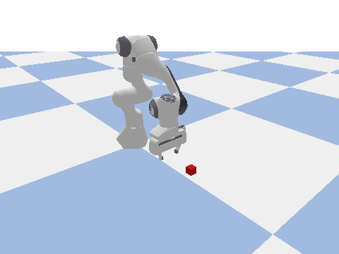
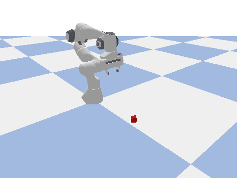
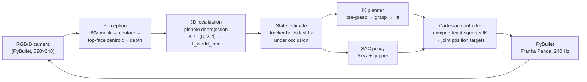

<div align="center">

# Vision-RL Pick-and-Place

**A Franka Panda that finds a cube with an RGB-D camera and picks it up, using a classical Vision + IK pipeline and a reinforcement-learning policy trained on CPU.**


-7c3aed)


 

*Left: learned SAC policy. Right: classical Vision + IK baseline.*

</div>

---

## Results

Evaluated on **held-out seeds** (10 000+, disjoint from training), random cube position over a 25 × 40 cm workspace.

| Controller | Object position from | Success | Episodes |
|---|---|---|---|
| Vision + IK baseline | Camera (perception) | **100%** (100/100) | 100 |
| SAC policy | Simulator ground truth (as trained) | __RL_GT__ | 100 |
| SAC policy | Camera (perception + tracker) | __RL_PERC__ | 100 |

| Perception metric | Value |
|---|---|
| 3D localisation error (top face) | 1.8 mm mean · 2.8 mm max |
| Yaw error | 0.5° mean · 3.8° max |
| Detection rate (unoccluded) | 100 / 100 |

Perception metrics are measured over 100 random placements against simulator ground truth.

Training: SAC, __STEPS__ environment steps, __TRAIN_TIME__ on a 4-core CPU, no GPU.

## Architecture



Both controllers share the same perception and the same low-level Cartesian controller. Only the decision layer differs, so their results are directly comparable.

### Design decisions

| Decision | Why |
|---|---|
| **Perception consumes only `(rgb, depth, K, T_world_cam)`** | Same interface as a RealSense/ZED driver, so the module transfers to hardware unchanged. |
| **Top-face depth gating** | Perspective makes the cube's side faces visible and biases the centroid. Keeping only pixels within 1 cm of the nearest surface cut the mean error from 3.3 mm to 1.8 mm (max 6.1 → 2.8 mm) over 100 placements. |
| **Yaw measured in the world frame** | The min-area rectangle edge is deprojected to 3D before taking `atan2`, so no camera-mounting convention is hard-coded. |
| **RL acts in Cartesian space (Δxyz + gripper)** | A 4-D action through IK is far more sample-efficient than 9-D joint control, which is what makes CPU-only training feasible. |
| **Train on ground truth, evaluate on perception** | Rendering a camera frame costs ~50 ms vs ~1.5 ms per physics step. Evaluating the trained policy on perceived state measures the estimation gap explicitly instead of hiding it. |
| **Tracker holds the last confident detection** | The overhead camera loses the cube under the gripper. Acting on the last good fix beats acting on nothing. |
| **Reward always uses true state** | The reward is a training signal, not a policy input, so it should not inherit perception noise. |
| **Typed, validated YAML config** | Unknown or missing keys fail at load time; no silent defaults. |
| **One physics client per scene** | Environments are isolated, so vectorised training works without global state. |

## Quickstart

```bash
git clone https://github.com/SEVT-Logistics-Private-Limited/My-AI-Engineering-Journey.git
cd My-AI-Engineering-Journey/projects/vision-rl-pickplace
python -m venv .venv && source .venv/bin/activate
pip install torch --index-url https://download.pytorch.org/whl/cpu   # CPU build, ~200 MB
pip install -r requirements.txt
```

```bash
python scripts/detect_object.py --trials 10          # Phase 1: camera → 3D position
python scripts/run_baseline.py --episodes 20         # Phase 2: Vision + IK pick-and-place
python scripts/evaluate.py --controller rl           # Phase 3: trained policy (models/sac_picklift.zip)
python scripts/evaluate.py --controller rl --obs-source perception
python scripts/train_rl.py                           # retrain from scratch (~30 min on 4 CPU cores)
tensorboard --logdir runs/
pytest -q                                            # 28 tests, ~10 s
```

Add `--gui` to `run_baseline.py` to watch in the PyBullet window, or `--video out.gif` to `evaluate.py` to record.

## The RL task

| | |
|---|---|
| **Observation (10)** | end-effector xyz · gripper width · object xyz · object − end-effector |
| **Action (4)** | Δx, Δy, Δz ∈ [−1, 1] × 3 cm · gripper (> 0 closes) |
| **Reward** | −‖ee − object‖ (reach) · +0.25 while both fingers touch (grasp) · +10 × lift height, capped at 5 cm (lift) · +10 on success |
| **Termination** | success (grasped and lifted ≥ 5 cm) or 100 steps (~4 s at 24 Hz) |
| **Reset** | cube at a random position; gripper starts at a random point 15–25 cm above the workspace |

A hand-written scripted expert solves the task through the same action API (tested in `tests/test_env.py`). That separates "is the environment solvable?" from "did the agent learn?", which is the first thing to rule out when RL fails.

## Repository layout

```text
vision-rl-pickplace/
├── config/default.yaml        Simulation, camera, perception, grasp and RL settings
├── src/pickplace/
│   ├── config.py              Typed + validated config loading
│   ├── sim.py                 PyBullet scene: Panda, cube, contacts
│   ├── camera.py              RGB-D camera with explicit intrinsics/extrinsics
│   ├── perception.py          Detection, 3D deprojection, yaw, tracker
│   ├── kinematics.py          IK + Cartesian control of the Panda
│   ├── pipeline.py            Classical Vision → IK → grasp baseline
│   ├── env.py                 Gymnasium environment (PickLift-v0)
│   └── utils.py               Transform helpers
├── scripts/
│   ├── detect_object.py       Phase 1 milestone
│   ├── run_baseline.py        Phase 2 milestone
│   ├── train_rl.py            Phase 3: SAC / PPO training
│   └── evaluate.py            Success rates and video recording
├── models/sac_picklift.zip    Trained policy
├── tests/                     28 tests: config, perception, IK, baseline, env
└── assets/                    GIFs and debug images
```

## Limitations and future work

- **Single, uniquely coloured object under fixed lighting.** HSV thresholding is the weakest link for the real world. Next step: a learned detector or instance segmentation, then point-cloud grasp pose estimation for clutter.
- **Fixed cube yaw during RL training.** The baseline handles any yaw; the policy was trained at yaw 0 to keep CPU training short. Adding yaw to the observation and a wrist-rotation action is the natural extension.
- **State-based RL.** The policy sees an estimated 3D position, not pixels. Visual RL (an image encoder + data augmentation, e.g. DrQ) would remove the hand-designed perception stage at a much higher sample cost.
- **No domain randomisation.** Friction, mass, camera pose and lighting are fixed, so sim-to-real transfer is untested. Randomising them during training is required before hardware.
- **Pick-and-lift, not place.** Adding a goal position (goal-conditioned policy, Hindsight Experience Replay) extends this to full pick-and-place.
- **Overhead camera occlusion.** The tracker assumes the object is static until grasped. A wrist camera or a second viewpoint would allow closed-loop re-grasping.

## Related topics in this repository

[VLA](../../docs/11-vla.md) · [ROS](../../docs/13-ros.md) · [Reinforcement Learning](../../docs/21-reinforcement-learning.md) · [Image](../../docs/04-image.md) · [Image Resolution](../../docs/05-image-resolution.md)
