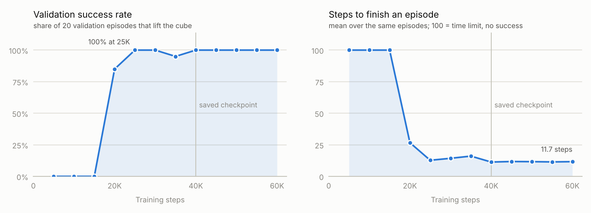
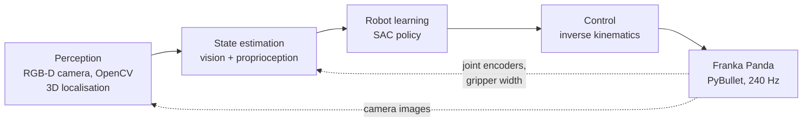

<div align="center">

# Vision-RL Pick-and-Lift

**Computer vision and robot learning for robotic grasping.** A simulated Franka Panda locates a cube with an RGB-D camera, tracks it through occlusion with a camera–proprioception state estimator, and picks it up with a reinforcement-learning policy trained on a CPU.

[](https://github.com/SEVT-Logistics-Private-Limited/My-AI-Engineering-Journey/actions/workflows/vision-rl-pickplace.yml)


 

*Left: learned SAC policy acting on camera estimates. Right: classical Vision + IK baseline. Real time, 24 fps.*

**99%** pick success from camera input · **1.8 mm** 3D localisation error · **18 min** training on a 4-core CPU · **46** tests in CI

</div>

---

## Highlights

- **End-to-end perception-to-action system.** RGB-D camera → OpenCV segmentation → 3D localisation → state estimation → learned policy → inverse kinematics, built in modular, separately tested stages.
- **Accurate 3D perception from a single RGB-D frame:** 1.8 mm mean error, 0.5° mean yaw error. A top-face depth gate that removes perspective bias cut the mean error from 3.3 mm.
- **Closed a perception gap.** Fed raw camera detections, the trained policy succeeded only 21% of the time. A state estimator fusing vision with joint encoders and gripper width brings it to **99% on held-out test episodes**.
- **Sample-efficient robot learning.** SAC reaches 100% validation success after 25,000 environment steps, on a CPU with no GPU. It also handles cube orientations never seen in training (100% at ±45°).
- **Rigorous evaluation.** Separate training, validation, development and test seeds; test results measured once after development was frozen; every episode bit-for-bit reproducible from its seed.
- **Production-style engineering.** 46 tests, CI on two Python versions with regression gates on the trained policy's success rate, and validated configuration.

## Skills demonstrated

| Area | In this project |
|---|---|
| **Computer vision** | RGB-D perception · HSV segmentation and contour analysis (OpenCV) · pinhole camera model with explicit intrinsics and extrinsics · depth-based 3D deprojection · perspective-bias correction · orientation estimation |
| **State estimation** | Fusing vision with proprioception (forward kinematics, gripper width) · occlusion handling · grasp detection from finger geometry |
| **Robot learning** | Gymnasium environment design · reward shaping and diagnosing reward hacking · SAC with Stable-Baselines3 · validation-based checkpoint selection · held-out and out-of-distribution evaluation |
| **Robotics** | Franka Panda in PyBullet · damped-least-squares inverse kinematics with null-space control · Cartesian control · top-down grasp planning |
| **ML engineering** | Seed-deterministic simulation · experiment protocol with data splits · pytest · GitHub Actions with model regression gates · typed, validated YAML config |

## Contents

[Results](#results) · [How it works](#how-it-works) · [Engineering challenges](#engineering-challenges) · [Key design decisions](#key-design-decisions) · [Quickstart](#quickstart) · [Testing and CI](#testing-and-ci) · [Project structure](#project-structure) · [Limitations and roadmap](#limitations-and-roadmap)

## Results

All numbers come from **100 held-out test episodes** (seeds 30000–30099), each with the cube at a random position in a 25 × 40 cm workspace. These seeds were evaluated once, after development was frozen. Every controller is scored by the same rule: an episode succeeds when the cube is held and lifted at least 5 cm.

| Controller | Object position from | Success rate |
|---|---|---|
| Vision + IK baseline | Camera | **100%** (100/100) |
| SAC policy | Simulator ground truth (as trained) | **99%** (99/100) |
| SAC policy | **Camera + state estimator** | **99%** (99/100) |
| SAC policy, cube rotated ±45° (unseen in training) | Simulator ground truth | **100%** (100/100) |

| Perception (100 placements vs ground truth) | Result |
|---|---|
| 3D localisation error, top face | 1.8 mm mean · 2.8 mm max |
| Yaw error | 0.5° mean · 3.8° max |
| Detection rate, unoccluded | 100% |

**Training:** SAC, 60,000 environment steps, 18 minutes on a 4-core CPU. Validation success first reaches 100% at 25,000 steps; the deployed policy is the best validation checkpoint, at 40,000 steps.

<picture>
  <source media="(prefers-color-scheme: dark)" srcset="assets/training_curve_dark.png">
  
</picture>

<details>
<summary>Training curve data (20 validation episodes per point)</summary>

| Training steps | Success rate | Mean episode length | Mean return |
|---|---|---|---|
| 5,000 | 0% | 100.0 | -114.20 |
| 10,000 | 0% | 100.0 | -84.34 |
| 15,000 | 0% | 100.0 | -84.02 |
| 20,000 | 85% | 26.6 | -17.41 |
| 25,000 | 100% | 12.8 | -1.51 |
| 30,000 | 100% | 14.3 | -2.58 |
| 35,000 | 95% | 16.1 | -4.71 |
| 40,000 (saved) | 100% | 11.3 | -0.29 |
| 45,000 | 100% | 11.8 | -0.71 |
| 50,000 | 100% | 11.7 | -0.78 |
| 55,000 | 100% | 11.4 | -0.32 |
| 60,000 | 100% | 11.7 | -0.60 |

Regenerate the chart from any run with `python scripts/plot_training.py --run runs/<name>`. The values are also in [`assets/training_curve.csv`](assets/training_curve.csv).

</details>

<details>
<summary>Evaluation protocol</summary>

| Seeds | Used for |
|---|---|
| 0 (one stream) | Training episodes |
| 1000 (one stream) | Validation during training: selects the saved checkpoint |
| 10000+, 20000+ | Development: debugging perception and determinism |
| **30000–30099** | **Test: the results above, evaluated once** |

Every episode is a pure function of its seed (see [Engineering challenges](#engineering-challenges), item 4), so `python scripts/evaluate.py` reproduces these numbers on the same PyBullet build. Both test failures are analysed under [Limitations](#limitations-and-roadmap).

</details>

## How it works



The loop runs at 24 Hz. The classical baseline shares the perception and the controller but needs no state estimator: it takes one photo before the arm moves, while nothing hides the cube, then runs a fixed grasp sequence. Both are scored by the same success rule: the cube is held and lifted at least 5 cm.

### 1. Perception: computer vision

<picture>
  <source media="(prefers-color-scheme: dark)" srcset="assets/perception_dark.png">
  
</picture>

*One RGB-D frame through the real detector, zoomed on the cube. Generated by `scripts/plot_perception.py`.*

- **Camera:** an overhead RGB-D camera (320×240, 40° field of view) with explicit pinhole intrinsics `K` and extrinsics `T_world_cam`. The module consumes only `(rgb, depth, K, T_world_cam)`, the same interface a RealSense or ZED driver provides, so it transfers to hardware unchanged.
- **Segmentation:** HSV thresholding with two hue ranges (red wraps around 0), a morphological opening, and the largest contour above an area threshold.
- **Perspective-bias correction:** the camera sees the cube's side faces as well as its top, which drags the centroid off-centre. Keeping only pixels within 1 cm of the nearest surface cut the mean error from 3.3 mm to 1.8 mm, and the max from 6.1 mm to 2.8 mm.
- **3D localisation and orientation:** the centroid and median depth are deprojected through `K⁻¹` and transformed to the world frame. Yaw comes from the minimum-area rectangle, measured in the world frame so no camera-mounting convention is hard-coded.

### 2. State estimation: vision + proprioception

Once the arm moves into view, the overhead camera alone is unreliable: the gripper partly hides the cube, and a grasped cube is invisible. `ObjectStateEstimator` combines the camera with signals any real arm has:

- **Occlusion gating:** a detection is trusted only if its blob covers at least 80% of the largest unoccluded blob seen.
- **Grasp-aware tracking:** once the fingers settle on the cube (width between face-to-face and the face diagonal, still for two frames), the estimate follows the hand through forward kinematics.

### 3. Robot learning: reinforcement learning

| | |
|---|---|
| **Algorithm** | Soft Actor-Critic (Stable-Baselines3), MLP 256×256, γ = 0.95 |
| **Observation (10)** | End-effector position · gripper width · object position · object − end-effector |
| **Action (4)** | Δx, Δy, Δz (up to 3 cm per step) · gripper open/close |
| **Reward** | −1 per step · −distance to the object · +0.25 while both fingers touch it · +10 × lift height (capped at 5 cm) · +10 on success |
| **Episode** | Success = held and lifted ≥ 5 cm, the same rule the baseline is scored by; time limit 100 steps (about 4 s at 24 Hz) |

The policy trains on simulator state, since rendering and processing a camera frame makes each step about 30 times slower (roughly 50 ms instead of 1.5 ms). It is then evaluated on camera estimates, which measures the perception gap instead of hiding it. A scripted expert solves the same environment through the same action interface (tested), which separates "is the task solvable?" from "did the agent learn?"

### 4. Control: inverse kinematics

PyBullet's damped-least-squares inverse kinematics, with a null-space bias that lets the wrist reach the commanded yaw, drives the end-effector to Cartesian targets. The baseline runs pre-grasp → grasp → lift; the policy issues small Cartesian steps.

## Engineering challenges

What broke during development, how each issue was diagnosed, and the measured effect of the fix. Every fix is covered by a test.

| # | Problem | Root cause | Fix | Result |
|---|---|---|---|---|
| 1 | Evaluation reward rose, but success stayed at 0% | **Reward hacking.** Holding the cube just below the success height earned grasp and lift bonuses every step, worth ~15 discounted, more than the one-time +10 success bonus. | A step penalty larger than the best per-step shaping reward, enforced by config validation | 0% → 100% validation success by 25k steps |
| 2 | 100% success with ground truth, **21%** with the camera | The estimate stayed on the floor while the cube was lifted, and partly hidden detections (42 of 330 px) were accepted | Camera + proprioception state estimator | 21% → 98% on development seeds |
| 3 | Estimate dragged 6 cm away during a failed grasp | **False attachment.** A corner pinch counted as a grasp. | Hold band from cube geometry, plus a finger-settle check | 98% → 100% on development seeds |
| 4 | Same seed, different outcome | **Non-deterministic resets.** Bullet keeps solver and contact caches across resets; `saveState`/`restoreState` did not clear them (verified). Trajectories diverged by up to 6 cm. | Rebuild the physics world each episode (60 ms) | Bit-identical rollouts per seed |
| 5 | Wrist reached only ~55% of the commanded rotation | The IK null-space rest pose pinned the wrist joint, and convergence checked position only | Bias the rest pose by the target yaw; check orientation too | Yaw error < 3° |

Complexity was added only where measurements justified it. One estimator rule never fired in 100 development episodes, so it was removed.

## Key design decisions

| Decision | Why |
|---|---|
| **Hardware-agnostic perception interface** | Consuming only `(rgb, depth, K, T_world_cam)` keeps the vision code unchanged on a real sensor. |
| **Cartesian action space through IK** | A 4-D action is far more sample-efficient than 9-D joint control, which is what makes CPU-only training practical. |
| **Train on state, evaluate on perception** | Fast training, plus an honest measurement of the perception gap. |
| **Reward computed from true state** | The reward is a training signal, not an input, so it should not inherit perception noise. |
| **Fresh physics world every episode** | Results depend only on the seed, never on episode order. |
| **Validated configuration** | Unknown or missing keys, and reward settings that allow hovering, fail at load time. |

## Quickstart

Requires Python 3.10+. No GPU needed.

```bash
git clone https://github.com/SEVT-Logistics-Private-Limited/My-AI-Engineering-Journey.git
cd My-AI-Engineering-Journey/projects/vision-rl-pickplace
python -m venv .venv && source .venv/bin/activate
pip install torch --index-url https://download.pytorch.org/whl/cpu   # CPU build
pip install -r requirements.txt
```

```bash
python scripts/detect_object.py --trials 10          # camera → 3D position, with error vs ground truth
python scripts/run_baseline.py --episodes 20         # classical Vision + IK pick-and-lift
python scripts/evaluate.py --controller rl           # trained policy on the test seeds
python scripts/evaluate.py --controller rl --obs-source perception   # ... acting on camera estimates
python scripts/train_rl.py                           # retrain from scratch (~18 min on 4 CPU cores)
python scripts/plot_training.py --run runs/<name>    # training curve → assets/
python scripts/plot_perception.py                    # perception figure → assets/
pytest -q                                            # 46 tests, ~10 s
```

Useful flags: `--gui` on `run_baseline.py` opens the PyBullet viewer; `--video out.gif` or `--video out.mp4` on `evaluate.py` records the episodes; `--min-success 0.9` makes `evaluate.py` fail below a success rate.

## Testing and CI

- **46 tests:** config validation, camera geometry, perception accuracy, the state estimator, inverse kinematics, the baseline pipeline, the Gymnasium environment, determinism, video and figures.
- **GitHub Actions** on Python 3.10 and 3.12, for every change to this project: the full test suite, a baseline smoke run, and **regression gates on the committed policy** (at least 90% success with ground truth and 80% with the camera), so a change that breaks the trained model fails CI.

## Project structure

```text
vision-rl-pickplace/
├── config/default.yaml        Simulation, camera, perception, grasp and RL settings
├── src/pickplace/
│   ├── camera.py              RGB-D camera with explicit intrinsics/extrinsics
│   ├── perception.py          Segmentation, 3D deprojection, yaw, state estimator
│   ├── kinematics.py          Inverse kinematics and Cartesian control
│   ├── pipeline.py            Classical Vision → IK → grasp baseline
│   ├── env.py                 Gymnasium environment (PickLift-v0)
│   ├── sim.py                 PyBullet scene with deterministic resets
│   ├── config.py              Typed, validated configuration
│   ├── video.py               GIF / MP4 writer
│   └── utils.py               Geometry helpers
├── scripts/
│   ├── detect_object.py       Perception demo and accuracy check
│   ├── run_baseline.py        Classical pipeline benchmark
│   ├── train_rl.py            SAC training (PPO also supported)
│   ├── evaluate.py            Evaluation, video recording, CI gate
│   ├── plot_training.py       Training-curve chart and CSV
│   ├── plot_perception.py     Perception figure
│   └── viz_theme.py           Shared figure colours
├── models/sac_picklift.zip    Trained policy (best validation checkpoint)
├── tests/                     46 tests
└── assets/                    Demo GIFs, perception figure, training curve
```

## Limitations and roadmap

**Known limitations**

- **Single, uniquely coloured object under fixed lighting.** HSV segmentation is the weakest link for real-world use.
- **Hidden displacement.** If the hand knocks the cube while the arm fully hides it, the estimate cannot recover until the cube is visible again. This caused the camera-mode test failure (seed 30056).
- **Rare policy stall.** In the ground-truth test failure (seed 30023), the policy held a tilted cube but hovered instead of lifting it.
- **No wrist rotation in the policy.** Rotated cubes still succeed because the 8 cm gripper opening exceeds the cube's 5.7 cm diagonal; elongated objects would need a yaw action.
- **Simulation only.** No domain randomisation yet, so sim-to-real transfer is untested. Determinism holds per PyBullet build.

**Roadmap**

1. Domain randomisation (friction, mass, lighting, camera pose) as the first step toward hardware.
2. Learned detection or instance segmentation, then point-cloud grasp poses for cluttered scenes.
3. A wrist camera or second viewpoint, to recover from hidden displacement.
4. Visual RL from pixels (an image encoder with augmentation, e.g. DrQ) to learn perception end to end.
5. Extend pick-and-lift to full pick-and-place (carry the cube to a goal position), with goal-conditioned policies and Hindsight Experience Replay.

## Background

Concepts behind this project are explained in this repository: [VLA](../../docs/11-vla.md) · [ROS](../../docs/13-ros.md) · [Reinforcement Learning](../../docs/21-reinforcement-learning.md) · [Image](../../docs/04-image.md) · [Image Resolution](../../docs/05-image-resolution.md)

## Author and contact

**Rishi Sasanala** · [rishisasanala@gmail.com](mailto:rishisasanala@gmail.com) · [GitHub](https://github.com/rishisasanala) · part of [My AI Engineering Journey](../../README.md)
